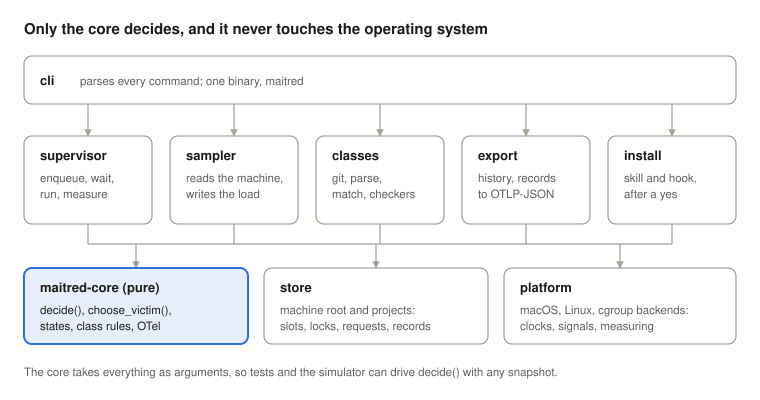
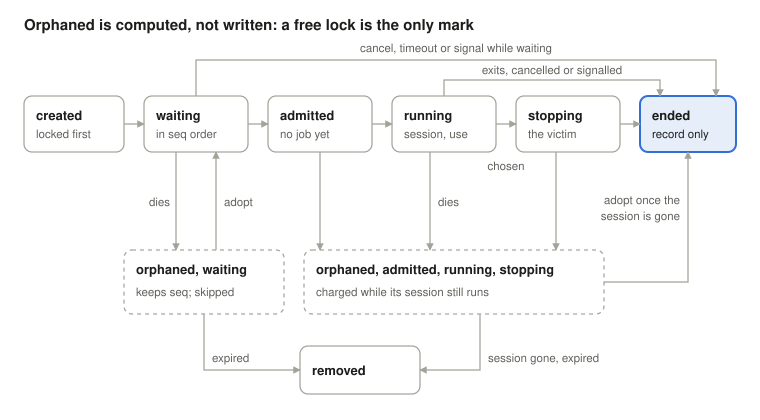

<!--
  Synced from the maitred architecture doc on claude.ai (rev 190, 2026-10-16):
  https://claude.ai/code/artifact/00385e4d-eabc-4436-b2d3-6016ffd43e58
  Draft and revise there; this file is regenerated from it, so edits made only here are lost.
  The drawings are docs/modules.svg and docs/ticket-states.svg, exported from the doc's drawings.
-->

# maitred architecture

2026-10-07 · Nicholas Allen Bickford Marshall

## Scope

This document turns the maitred design into something buildable: exact states, file formats, algorithms and crates. The [design](https://claude.ai/code/artifact/b0753fb5-a907-459b-8266-2b18f0401e5b) (`DESIGN.md`) says what maitred is and why; nothing here changes it. Where building forces a design change, it goes back to the design doc first.

This document decides:

- how the binary is divided into modules, and which of them may touch the operating system;
- every state a ticket can be in, every transition, and which single writer makes each one;
- the byte-level format of every file, and how a locked file is written in place without a reader ever seeing half of it;
- the admission function and the kill policy, step by step, including the parts the design left to here (settle, minimums, aging, victim choice);
- how a supervisor runs, measures, stops, nests and cleans up;
- what the sampler reads on each platform and how it maps to OpenTelemetry;
- the crate chosen for each of those, and why.

It does not decide the numbers in the machine config. Those come from a week of the sampler running observe-only on a real machine.

## Process model and modules

maitred is a Cargo workspace whose two shipped crates are `maitred-core`, which decides and touches nothing, and `maitred`, the one binary, which does all the reading, writing, locking and spawning around it.



- **maitred-core** holds the types (ticket, snapshot, reservation, record), `decide`, `choose_victim`, the state machine's transitions, class-rule matching, the hook's spotter and the OTel data-point types. No file, clock, process or environment access: everything it needs arrives as an argument. That is what makes admission and the kill policy testable by property and replayable by the simulator.
- **maitred** holds the commands and the layers that face the operating system: `store` (the machine root and project files, slots, locks), `platform` (one backend each for macOS, Linux and cgroups: clocks, signals, sessions, measuring, sampling) and the command modules on top, including the hidden `__hold` and `__drain` entry points the supervisor re-executes itself as.
- **Three more crates are never shipped:** `maitred-sim`, the deterministic simulator on top of `maitred-core`; and `maitred-scenario` and `maitred-testkit`, the test kit, which has its own owner (Test kit). All five live under `crates/`, with the root `Cargo.toml` as a virtual workspace holding the shared lints, `rust-version` and dependency versions.

Every process is one of three kinds, and none outlives its purpose:

| Process | Started by | Runs as | Lives | Holds |
| --- | --- | --- | --- | --- |
| supervisor (`run`, or the detached child of `submit`) | a worker | the worker's user, in its sandbox | until its job's record is written | its ticket's lock; its end of the holder's gate; its copy of the job's slots; briefly, `admit.lock` |
| holder (`maitred __hold`) | the supervisor, when the ticket is created; parked at its gate until admission | the worker's user, in the same sandbox | while any process of the job's session lives | the job's session, as its leader; its use file; while it is killing its job, its stop marker's lock; the job's slots; briefly, `admit.lock` |
| drain (`maitred __drain`) | a supervisor whose rule keeps leftovers | the worker's user, in a session of its own | until the kept processes close their output | nothing |
| sampler (`watch`) | an administrator, or launchd or systemd as installed | the maitred user, never root, except inside a container that is its own machine | until stopped | `sampler.lock` |
| short commands (`status`, `cancel`, `wait`, `result`, `export`, `classes`, `guard`) | anyone | the caller | one call | nothing for longer than a read |

Every helper is started by re-executing the maitred binary, never by a bare `fork`: the supervisor may have threads, and a child forked from a threaded process can deadlock on a lock another thread held at the fork. The holder is started when the ticket is created, not at admission, so it is the binary that enqueued (an upgrade during a long wait can't swap it), and a failure to start shows before the wait, not after it. Every helper is given `maitred` as its process name, so `ps` and `pkill maitred` find it. Each sets close-on-exec on every descriptor it inherited but keeps, as its first act; the job, in turn, inherits only its slots (Supervision).

## Ticket state machine

A ticket has three written states, an end, one marked state and one computed state. `waiting`, `admitted`, `running` and its end are written by its supervisor. `stopping` is marked by the job's holder, in a file of its own beside the ticket, because the holder is what carries out a kill (Kill policy). Orphaned is never written, only seen.



| From | To | When | Written by |
| --- | --- | --- | --- |
| (none) | waiting | the ticket is created, locked and renamed into place, with the next `seq`; its holder is started and parked at its gate | its supervisor, under `admit.lock` |
| waiting | admitted | `decide` admits it; its slots are taken | its supervisor, under `admit.lock` |
| admitted | running | the supervisor writes the holder's pid, session and start time into the ticket, then opens the gate; the holder forks the job and execs the command | its supervisor |
| running | stopping | `choose_victim` names it | its holder, under `admit.lock`: it creates and locks the stop marker |
| stopping | ended | the job's processes are gone (or a bounded wait has passed) and the sampler has published a sample whose interval began after that: record first, then the ticket, then the marker | the supervisor, then the holder |
| running | ended | the job exits, is cancelled or signalled: record first, then delete | its supervisor |
| waiting or admitted | ended | cancelled, timed out, signalled, or the spawn failed: record first, then delete; the parked holder sees its gate close and exits | its supervisor |
| any | orphaned (computed) | its supervisor dies; the kernel frees the lock | nobody: readers see the free lock |
| orphaned, waiting | waiting | adopted (same project and uid, the command still matches, confirmed interactively); the old parked holder has already exited, and the adopter starts a new one | the adopter, who now holds the lock |
| orphaned, admitted | waiting | adopted, keeping its `seq`. Its slots are dropped, since a waiting ticket holds none. No job ran: a holder at its gate exits when its supervisor's end of the gate closes | the adopter |
| orphaned, running or stopping, record present | removed | the job had finished; only the deletion was lost | any later supervisor of the same uid in the same project (the sweep), or `wait` |
| orphaned, running or stopping, session alive | (unchanged) | adoption is refused: the job is still running, and adopting would run it twice. Its holder still measures it and carries out a kill | nobody |
| orphaned, running or stopping, session gone, no record | ended + new waiting ticket | adopted: the record says `interrupted`; the command is queued again as a new ticket | the adopter |
| orphaned | removed | past `orphan_ttl`, and not running with a live session: the sweep writes an `expired` record into the project first | the sweep of the next supervisor of the same uid in the same project |

Three invariants follow, and the tests check each: a ticket's file only changes while someone holds its lock; no job runs whose session isn't already in its ticket; and no ticket disappears before its record exists. A record is created exclusively (written under a temporary name, then linked into place, which fails if one exists), so two writers can never both write one. So `wait` on an id always ends: with the record, or, if there is neither ticket nor record, with the outcome `lost`.

## Files and the write protocol

Every file has one owner, one stated mode and one writer; a ticket is rewritten in place, into one of two slots, so a reader always finds one complete copy; and every lock is checked to still belong to the file at its path.

### Where things live, and who owns them

`maitred install machine`, run once by an administrator, creates a dedicated system user (`_maitred` on macOS, `maitred` on Linux), the machine root, the machine config and the sampler's service. Nothing below is created on first use by whoever happens to run first.

| Path | Owner | Mode | Written by |
| --- | --- | --- | --- |
| machine root: `/Users/Shared/maitred` (macOS), `/var/lib/maitred` (Linux) | maitred user | `0755` | nobody after install |
| `admit.lock`, `sampler.lock` | maitred user | `0644` (a lock needs only a read-only open) | never written; only locked |
| `tickets/` | maitred user | `1777`: any user creates; only a file's owner (or root) deletes it | supervisors, each its own ticket; holders, each its own use file and stop marker |
| `tickets/<id>.tk` | the ticket's owner | `0644` | its supervisor |
| `tickets/<id>.use` | the ticket's owner | `0644`, replaced by temporary name and rename | its holder: the job's measured use and the interval it covers |
| `tickets/<id>.stop` | the ticket's owner | `0644`, created exclusively, locked by the holder while it exists | its holder |
| `requests/` | maitred user | `1777`, like `tickets/` | nobody; holds one directory per ticket |
| `requests/<ticket-id>/` | the ticket's owner | `0700`, created before the ticket: only the same user can send a request | the owner (its `project` file); senders of the same uid |
| `orphans/` | maitred user | `1777` dir; records `0600`, so only their owner reads them | `maitred clean`: the `expired` records of tickets whose project no worktree is used from |
| `pools/<pool>/<n>` | maitred user | `0755` dir, `0644` empty files, one per slot, kept in line with the machine config by the sampler (Pools change while running) | never written; a slot is taken by locking its file |
| `load/` and everything in it | maitred user | `0755` dir, `0644` files | the sampler only |
| `seq` | maitred user | `0666`, made at install | the creator of each new ticket, under `admit.lock`: the last `seq` given out |
| `order` | maitred user | `0644`, made at install | `maitred queue move` as root or the maitred user, under `admit.lock`: the moved tickets and their positions |
| `victim` | maitred user | `0666`, made at install, empty when no breach is under way | holders, under `admit.lock`: the victim named for the breach under way (Kill policy) |
| machine config: `/Library/Application Support/maitred/config.toml`, `/etc/maitred/config.toml` | root | `0644` | an administrator |

These modes separate users. Between processes of one user, which is what agents of one person are, they separate nothing: any of them can delete or rewrite another's tickets, and maitred makes no claim otherwise (design, Principle and threat model). There is no per-user state outside the machine root and the projects: what the sweep needs to find a ticket's project sits in `requests/<ticket-id>/project`, readable only by the ticket's owner. `maitred install claude-code` adds exactly two machine paths to the agent sandbox's write allowlist, `tickets/` and `requests/`, after showing the change; the sampler's files stay unwritable. The Linux root lives under `/var/lib`, not `/var/tmp`, so no temporary-file cleaner ages out its lock files; the install also drops a `tmpfiles.d` exclusion for anyone who moves it. The machine root's path and the `--machine-config <path>` flag can be changed only in debug builds; both are compiled out of releases.

**No machine root, no queue.** When the machine root doesn't exist, `maitred -- <cmd>` warns once and runs the command straight through, with no ticket and no record, so scripts and hooks that call maitred keep working on CI runners and machines nobody has set up. A root that exists but is on a network filesystem or not owned as installed is an error (69): that is a broken install, not a missing one.

**Slot pools.** A pool is declared in the machine config with a name, a size and the environment variable that carries the number, such as `test_env`, 16, `TEST_ENV_NUMBER`. A slot is taken by holding an exclusive lock on its file, so a free lock is a free slot, with nothing to clean up. Only the admitter ever locks slot files: under `admit.lock` it tries the lowest number no ticket names, takes the next one if that try fails, and writes the number into its ticket. The snapshot's builder, holding admit.lock and so an admitter, also tries each slot no ticket names: one it can't lock is held outside any ticket (a leftover daemon, or a file the sampler hasn't made yet), counts as taken, and no drain frees it; so a ticket whose slot is held that way waits as NoSlot instead of being admitted on paper pass after pass. Every other reader learns which slots are taken from the tickets' `slots`, never by locking, so a `status` can't make an admission fail. The locked descriptor goes to the holder at its start and from the holder to the job and everything the job starts, and the supervisor keeps its own copy until it has seen the session empty. So a slot stays taken for exactly as long as anything that might still use its number is alive: the job, a holder whose supervisor has died, a stopped job, a kept leftover, or a daemon the job left behind with `setsid`. The last of those holds a slot with no ticket naming it; `status` lists any taken slot no live ticket names as held outside any ticket, since flock can't say by whom. First-in never waives a slot: a job that asks for one waits for a free one. Agents can't delete the slot files: they are the maitred user's, in a directory only it writes.

**Each pool describes its numbers.** A pool's entry in the machine config gives its name, its size, the variable that carries the number, its `first` number (default 1), and `empty_first`, which passes the first slot as an empty string (parallel_tests' convention, where the first process's `TEST_ENV_NUMBER` is empty and the rest are 2, 3 and so on). Its numbers run from `first` to `first + size - 1`. A job takes at most one slot from each pool, however many of its programs ask for that pool.

**Pools change while running.** Every pass reads the machine config, so a new pool or a new size takes effect at the next pass. The sampler, the only process that writes in the machine root, keeps `pools/` in line with the config on every sample: it creates a missing slot file, and removes a file outside the pool's range once its lock is free. A pool that shrinks retires numbers rather than removing them: a number outside the range is never handed out again and uses up none of the range, but a job holding one keeps it until nothing that might use it is alive. If the sampler is down when a pool grows, the new slot files don't exist yet, so the admitter can't lock them and treats them as taken: the job waits, and `status` says why. It never double-books.

### Locks that can't be fooled

- **Liveness reads take a shared lock.** A reader tests a ticket with `flock(LOCK_SH | LOCK_NB)`: it fails while the owner holds its exclusive lock, and many readers can test at once without making a dead ticket look alive to each other. Only an adopter or the sweep takes `LOCK_EX` on someone else's ticket.
- **Every lock is re-checked against its path.** After taking any lock (`admit.lock`, `sampler.lock`, a ticket), the holder compares the locked descriptor's inode with the inode now at the path, and starts again on a mismatch. A file deleted and recreated underneath can't produce two owners.
- **`admit.lock` is taken with a deadline.** A supervisor tries every 50 ms; after 10 s it prints how long the lock has been held and keeps trying. flock can't say who holds it; `status` reports the wait.

### The ticket: two slots and a lock

A ticket is `tickets/<id>.tk`, mode `0644`, a file of two fixed 4 KiB slots:

```
offset  size  field
     0     8  magic "MTRDTICK"
     8     4  crc32 u32       IEEE CRC-32 of bytes 12 .. 96 + length
    12     4  length u32      payload bytes, at most 4000
    16     8  generation u64
    24     1  major u8        4
    25     1  minor u8        0
    26     1  class u8        0 light, 1 heavy, 2 quiet
    27     1  state u8        0 waiting, 1 admitted, 2 running
    28     4  cpu_millicores u32
    32     4  mem_mb u32
    36     4  sid i32
    40     8  seq u64
    48     8  last_pass u64   ms on the boot clock; 0 = never
    56     8  admitted_at u64 ms on the boot clock; 0 = never
    64     8  recreated_at u64 ms on the boot clock; 0 = never
    72     8  holder_start u64 the platform's own start time (below)
    80     4  pgid i32
    84     4  holder_pid i32
    88     8  boot u64        first 8 bytes of SHA-256 over the boot id and pid namespace
    96  ≤4000  JSON payload, then zero padding to 4096
```

- **Encoding.** Every integer is little-endian, whatever the machine, so the test kit's reader, a hex dump and a reader on another architecture agree without knowing the writer. The header is 96 bytes and every field sits at its natural alignment. The checksum (IEEE CRC-32, as `crc32fast` computes it) sits right after the magic so that what it covers is one run: bytes 12 to the end of the payload. A slot torn anywhere a reader looks fails it; the zero padding isn't covered, since a reader never uses it. A `length` over 4000 fails the slot. The header's `major` and `minor` are the payload's `v`: one version for the file.
- **The fixed header carries everything another reader needs to place, charge and judge the ticket:** class, state, `seq`, reservation, when it last ran a pass, when it was admitted, whether it was just recreated, and its session and holder. So a reader that can't understand a newer payload still charges it at its own reservation, sees whether it has stalled, and can check its session (Versions). The magic never changes; `major` does.
- **Times are on the boot clock,** the one that keeps counting through sleep and never steps: `CLOCK_BOOTTIME` on Linux, `mach_continuous_time` converted with `mach_timebase_info` on macOS, in milliseconds. Every process of one boot shares it, so a wall-clock step (NTP, a person setting the date) can't make every waiter look stalled or a recreation look recent. `boot` says which boot the times and pids belong to: a reader compares it with its own before trusting either, which a reader that can't parse a newer payload still can.
- **`holder_start`** is the platform's own value, only ever compared for equality with a fresh read of the same pid: on Linux, field 22 of `/proc/<pid>/stat` (clock ticks since boot); on macOS, `pbi_start_tvsec × 1000000 + pbi_start_tvusec` from `proc_pidinfo(PROC_PIDTBSDINFO)`.
- **An unknown `class` or `state` code** (a newer minor) is read as heavy and running: the ticket keeps its place by `seq` and is charged at least its header's reservation and the heavy minimum.
- **Writing.** The owner writes generation g+1 into the slot that holds g-1, then `fdatasync` on Linux (`fsync` on macOS, which orders nothing on the disk: after a power loss both slots may fail, and the ticket then reads as unknown and unlocked, which the sweep removes). The slot holding g stays intact throughout.
- **Reading.** Read both slots in one 8 KiB read, keep those that pass, take the higher generation. If neither passes, read again, up to three times; a reader that still finds no valid slot treats the ticket as unknown (Versions).
- **Creating without a gap.** Create `requests/<id>/` (mode `0700`; if it already exists and isn't ours, pick a new id), write its `project` file, then create `tickets/.new-<id>`, lock it, write the first slot and a zeroed second, so the file is its full 8 KiB from the start, and rename it to `<id>.tk`. A rename keeps the inode, and the lock lives on the inode, so the ticket appears already locked.
- **Still mine?** On every pass a supervisor checks that the inode at its ticket's path is the one it holds locked, and that its request directory and `project` file are still there. If either was deleted (an agent tidying `tickets/` or `requests/`), it recreates it under `admit.lock`, keeping its `seq`, sets `recreated_at`, and warns; the record notes it. The recreated ticket's generation carries on from the last its supervisor wrote, so a ticket's generations only ever go up, across a recreation too. While any ticket's `recreated_at` is recent (within the stall limit), `decide` admits nobody and `choose_victim` chooses nobody, because other deleted tickets may not have come back yet.
- **Ids.** `<unix-ms, hex>-<64 random bits, hex>`. Queue order is `(position, id)`, where a ticket's position is `(seq, 0)` unless an administrator moved it (Moving a ticket), so two tickets that end up with one position still sort the same way for every reader.

### The ticket's payload

```
{
  "v": "4.0",
  "id": "0192f3a1c2e0-9f3c2a7e5b1d4c88",
  "seq": 4183,
  "boot": "…",
  "pidns": "4026531836",
  "user": 501,
  "project": "7c41e09a5d2b… (a hash of the project's git common directory)",
  "class": "heavy",
  "label": "nightly-mutants",
  "reservation": { "cpu_millicores": 2000, "mem_mb": 1200 },
  "slots": { "test_env": 3 },
  "flags": ["edited-classes"],
  "state": "running",
  "waited_ms": 41200,
  "last_pass": "2026-10-07T21:14:02Z",
  "admitted_at": "2026-10-07T21:13:58Z",
  "recreated_at": null,
  "leader": { "pid": 48210, "sid": 48210, "pgid": 48211, "start": "…" }
}
```

- `seq`: under `admit.lock`, one more than the largest of the machine root's `seq` counter, the largest `seq` in any ticket's header, and the sampler's high-water mark (`seq_high` in `load/now.json`); the creator writes the new value back to `seq`. Agents can't delete the counter (the root is the maitred user's), and taking the largest of three sources means a counter set lower changes nothing and one set higher only skips numbers. So neither deleting every ticket nor restarting the sampler can put a newcomer ahead of tickets that come back.
- `boot`: read by the supervisor itself: Linux `/proc/sys/kernel/random/boot_id`; on macOS, the start time of process 1 from `sysctl` `KERN_PROC_PID`, which a sandbox allows. No dependence on the sampler.
- `pidns`: the pid namespace on Linux; empty on macOS. Process ids are only compared within one boot and namespace.
- `project`: the first 16 bytes of SHA-256 over the real path of the project's git common directory (or of its `.maitred/` outside git). Every worktree gets the same value, and two racing first runs can't disagree, since nothing is stored. The label is never shown to other users; `status` shows other users' tickets as user, class, reservation and state only.
- `waited_ms` and the aging and hold timers run on the clock that stops while the machine sleeps, so a night's sleep doesn't age a ticket. The payload's times are RFC 3339 for people; decisions use the header's, on the boot clock. `last_pass` is when the owner last started a pass, waiting or running; it is written before contending for `admit.lock` and again on every poll interval of the wait for it, so a slow lock never makes a live supervisor look stalled.
- `leader`: the holder's pid, the session it leads, the job's first process group and the holder's start time. A holder counts as alive only if `kill(pid, 0)` succeeds or fails with EPERM, its start time still matches, and it isn't a zombie (`SZOMB` on macOS, state `Z` on Linux, from the same read): an exited holder its stopped supervisor hasn't reaped yet is dead. A `pgid` or `sid` of 0 or 1 is never accepted.
- `flags`: how this run differs from an ordinary one, such as `edited-classes` (the class file differed from the committed or the default branch's copy) or `recreated` (the ticket was deleted under it).
- `label`: the job's `--label`, or null. `wait --label` and `status` find jobs by it, and the test kit maps tickets to a scenario's jobs by it.
- The job's use isn't in the ticket: its holder writes it to `tickets/<id>.use` on every pass, because the holder keeps measuring while the supervisor is stopped, stuck or dead. The use file also carries when that pass started, on the boot clock (holder_pass_ms), so a reader can tell a holder that has stopped passing. The sampler copies it into each sample (holder_passes), whatever the use's window, so every holder judges from the same figure.

### Requests

`requests/<ticket-id>/`, created by the ticket's owner with mode `0700` before the ticket itself, holds `project` (the real paths of the project's working tree and its git common directory) and the requests: `<request-id>.json`, written once (temporary name, then rename), with `kind` (`cancel`, `update` or `nested`), the change, the sender's project, working directory, ticket (if it has one) and pid, and a reason. The target's supervisor applies or rejects each one, notes it in the record, and deletes it. A `nested` note is how a nested run tells its parent it ran, so the parent's record can list it. Another user can't write here at all; a person who needs to cancel another user's job does it as that user (`sudo -u`) or as root.

**The stop marker.** `tickets/<id>.stop` is created exclusively by the job's holder when `choose_victim` names it, and holds the threshold and the time of the kill. The holder keeps an exclusive lock on it (LOCK_EX), so a reader's shared try-lock tells a live marker from a dead holder's, until the job is gone (or its bounded wait has passed) and the sample after has been published, then deletes it. On every pass while it exists, the holder checks that the inode at the path is the one it holds locked, and recreates it if it was deleted (an agent tidying `tickets/`); while a ticket's marker is being recreated, its `recreated_at` freezes `choose_victim` as for a deleted ticket. A marker whose lock is free belongs to a dead holder, and readers ignore it.

**Moving a ticket.** An administrator reorders the queue with `maitred queue move <id> --before|--after <other-id>`, run as root or the maitred user. It takes `admit.lock`, writes the moved ticket's position into the machine root's `order` file (temporary name, then rename), and releases the lock. A position is the other ticket's `seq` with a smaller or larger `sub` than any position already there, so the moved ticket sorts just before or after it; nobody's ticket or `seq` changes, so the invariant that only a ticket's owner writes it still holds. Since every decision is made under `admit.lock`, no waiter ever sees half a move, and nothing needs pausing. Entries whose ticket is gone are ignored, and the sweep drops them. The ticket's record notes that it was moved, and by whom. Moving changes only order: a moved ticket still meets its class rules, the budget, its slots and the live limits, and a ticket draining the machine keeps draining. Owners can't move their own tickets in v1, since moving ahead of another user's is jumping the queue; they can cancel and resubmit.

### Project files

A project's records live in its working tree, `.maitred/records/<id>/`, which the install adds to `.gitignore`. Not the git directory: some agent sandboxes make `.git` read-only (Codex's does by default). Each worktree keeps its own records; `wait` and `result` look in every worktree that `git worktree list` names. Outside git, the project is the nearest directory holding `.maitred/`; with none, maitred refuses with a message saying to create one (78). If the records directory can't be written, maitred refuses before any ticket exists (73), since a run it can't record is a run `wait` can never finish.

| File | Holds | Written |
| --- | --- | --- |
| `job.json` | command line, working directory, environment keys, resolved class, the class file's and checker's hashes and whether each differed from the committed copy | once, at enqueue |
| `record.json` | the ticket's last payload, start and end, exit status or signal, how it ended (completed, cancelled with sender and reason, timed out, killed with its threshold, interrupted, holder lost, expired, lost), sleep seconds, overuse, nested runs, the samples around it, flags | once, before the ticket is deleted, created exclusively |
| `log` | head and tail of the job's output, capped (default 64 KiB each) | while the job runs, and by the drain afterwards |

### The sampler's files

All in `load/`, written only by the sampler as the maitred user:

- `now.json`: the latest sample, replaced by temporary name and rename.
- `history/<date>.jsonl`: OTel data points, one file per day, deleted after the retention period.
- `admissions.jsonl`: each admission the sampler saw, for settle; kept one hour.

### Versions

Every file carries a version. A ticket of a newer minor, whose payload a reader can't fully understand, is placed and charged from its fixed header. waited_ms, pools and slots are in the payload only, so such a ticket isn't aged, and its slots are learned by the admitter's lock attempt. A ticket of a newer major is unknown, like one with no valid slot, since a new major may change the header too. A ticket with no valid slot at all is unknown: while its lock is held it is charged at the heavy minimum and placed last, and, like an orphan, it blocks neither first-in nor a quiet job's idle check and no drain counts on freeing it, since it may be a waiter (if it is really running, the sample shows its load); once its lock is free, it is charged nothing, and the sweep of a supervisor of the same uid deletes it (there is no project to write a record into). The magic and the fixed header never change within a major version; a new major is a migration with its own release note. Two binaries of different versions on one machine may still run different `decide` and `choose_victim` logic over the same files; the machine config can name a minimum version, below which a supervisor refuses to start.

## Admission

Admission is one pure function, `decide(snapshot, me) -> Decision`, in the core module: no I/O and no clock, so every waiter computes the same answer from the same snapshot, and tests and the simulator can drive it with any snapshot.

### One pass

A waiting supervisor, every `poll_interval` (default 2 s, with up to 20% jitter):

1. Writes `last_pass` into its own ticket (its own lock is enough) and checks the ticket and its request directory are still its own (Files).
2. Takes `admit.lock` (with the deadline and inode check above), rewriting `last_pass` every poll interval while it waits, so a long wait for the lock never makes it look stalled. Its signal thread defers a Ctrl-Z that arrives while it holds the lock until the lock is released, so a stopped supervisor never holds it.
3. Builds the snapshot, leaving out any time from another boot (the load file and each admissions entry carry their boot): every ticket's header, payload and liveness (a shared try-lock each), every stop marker and whether its lock is held, `load/now.json` and its age, the last heavy admission (the latest of `load/admissions.jsonl` and the `admitted_at` of living heavy tickets), the moves in `order`, the machine config, and `now`.
4. Runs `decide`.
5. On **Admit**: writes its ticket as `admitted`, takes the lowest free slot of each pool its rule asks for and writes the numbers into the ticket, all still holding the lock, so the next snapshot already charges it; releases the lock; starts the job.
6. On **Wait(reason)**: writes `waited_ms` and the reason; releases the lock; prints the reason if it changed; sleeps.

### Inside `decide`

All CPU figures are millicores and all memory figures megabytes; the sampler converts its fractions before writing.

```
charged = living tickets that are admitted or running
        + orphaned running tickets of this boot and namespace whose holder is alive   # reservation only
        + locked tickets with no readable slot (heavy minimum; budget only, like an orphan)
waiting = living waiting tickets that aren't stalled, by (position, id)

if any ticket's recreated_at is recent:
    wait(tickets being recreated)
if load is stale, or a critical reading (cpu, memory) is missing:
    if I am quiet and not due (past quiet_max_wait): wait(quiet needs idle)   # no load figures, most often a wake, is no time for a benchmark
    admit me only if no living ticket is charged and I am first in waiting, skipping quiet tickets not yet due and tickets whose slots aren't free   # a due quiet ticket gets in tainted      # plain-lock fallback; stalled means no pass for 3 stall limits
    else wait(no reliable load)
if mem_available < mem_floor or cpu_load > its ceiling or gpu_used > gpu_ceiling:
    wait(live limits)
if any living charged ticket is quiet:
    wait(quiet job running)

free.cpu = capacity.cpu - cpu_used        - Σ charged max(0, reserve.cpu - used.cpu)
free.mem = mem_available - mem_floor      - Σ charged max(0, reserve.mem - used.mem)   # never plan below the floor
counts   = running heavy count; last_heavy = last heavy admission

for t in waiting:
    if allowed(t, counts, last_heavy, load) and reserve(t) fits free:
        if t is me: admit
        if t is quiet: stop the walk                                    # nothing starts beside it, even in this walk
        free -= reserve(t); update counts and last_heavy as if t were admitted
    else if no living ticket is charged and nothing admitted yet in this walk and allowed(t, ...) and t's slots are free and reserve(t).mem fits free.mem:
        if t is me: admit                                               # first in: waives only cores
        stop the walk
    else if t is quiet and is due (past quiet_max_wait) and fits_once_drained(t):
        stop the walk                                                   # let the machine drain for it
    else if t is aged and only the budget held it (not its class, not a slot) and fits_once_drained(t) and its hold hasn't lapsed:
        free -= reserve(t)                                              # only the budget keeps it out: hold its place
    else if t isn't quiet and its hold has lapsed and allowed(t, ...) and fits_once_drained(t):
        stop the walk                                                   # drain the machine for it, then first in
wait(the first rule that held me)
```

| Term | Exact meaning |
| --- | --- |
| `reserve(t)` | `max(t.reservation, class_min[t.class])` per dimension, capped at capacity. It fits free only if, besides cores and memory, each pool it asks a slot of has a free one: a slot no ticket names, and that no ticket admitted earlier in this walk has taken on paper |
| `used` | a running ticket's use as the sampler copied it into the current sample (`jobs` in `load/now.json`) from the job's holder, which writes it every pass; only a measurement whose window overlaps the sample's own interval is copied. Otherwise 0, so the ticket holds its whole reservation. Taking both terms from one sample keeps a job from falling out of both. Orphans and unknown tickets count as using nothing |
| `cpu_load` | the CPU figure this platform's limit reads. There are two, each with its own name, scale and ceiling, because they answer different questions: how much work is being delayed, and how much is queued for the cores. On Linux and in a cgroup, `cpu_stall`: the fraction of the last sample interval in which some task waited for a CPU, differenced from `/proc/pressure/cpu` (from the container's cgroup when there is one, which is why it is used rather than a machine-wide run queue), 0 to 1, against `cpu_stall_ceiling`. On macOS, which has no stall figure, `cpu_runnable_per_core`: the 1-minute load average per core, which lags (What it reads), against `cpu_runnable_ceiling`. No formula maps one onto the other. A machine config belongs to one machine and its ceilings come from that machine's observe-only week; until then the live ceilings start at 0.3 and 1.5, and the kill ceilings at 0.6 (cpu_stall_kill_ceiling) and 2.0 of maitred's running threads per core (cpu_threads_kill_ceiling). If the platform's own figure is missing there is no CPU limit: Linux never falls back to its runnable figure, which is host-wide inside a container. `status` names the figure in use. Not utilisation, which reads 100% for one healthy build on every core |
| allowed | **light:** always. **heavy:** fewer than `max_running.heavy` charged or admitted on paper, and `now - last_heavy >= settle`. **quiet:** no living ticket charged or admitted on paper, and `quiet_streak >= 2` in the load file; or it has waited past `quiet_max_wait`, in which case the streak isn't needed. A quiet job that gets in without the streak, by this rule, by first-in or after a drain, has its record marked `tainted`; one that had the streak isn't, however long it waited |
| aged | waited past `aging` (any class), counted on the clock that stops in sleep. An aged ticket that its class allows but the budget doesn't holds its reservation out of `free`, so later tickets can only fill around it, and it gets in as soon as the budget it holds is really free. The hold lapses after `aging_hold` more, so a ticket that can't fit doesn't block everyone behind it for ever; from then on it drains the machine instead, as a due quiet ticket does: the walk stops at it, nothing new starts, and once no living ticket is charged it gets in first. It drains only while its class allows it, since draining frees nothing a class rule (settle, max_running) waits on, and only while its memory fits once drained; a ticket that could never fit doesn't stop the queue, it waits, and status says load from outside maitred keeps it out. So every ticket that can fit is admitted eventually, at the cost of the queue waiting for the longest job running when the drain began. One that its class rules keep out (settle, `max_running`) holds nothing, since holding budget wouldn't let it in sooner |
| due quiet | past `quiet_max_wait`, a quiet ticket stops the walk so the machine drains for it, until it gets in. Draining is what gives a job that needs an idle machine its empty queue under steady traffic; what draining can't remove (load from outside maitred) is why it then runs tainted. Like first-in, it never waives memory |
| fits once drained | `reserve(t)`'s memory is at most `mem_available` less mem_floor, plus what each living charged ticket holds (its measured use, or its whole reservation when unmeasured): the most a drain can free, since a drain waits only for living jobs and an orphan may run on; and every pool it asks of is declared and has a slot that no orphan or other non-living ticket names, since a drain can't free those either. A ticket past that would wait at the head of a drained queue for ever, so it doesn't drain |
| first in | when no living ticket is charged, the first ticket that its class allows gets in even if its cores exceed the budget. It never waives memory (over-committing memory is what takes a machine down, so a job whose memory doesn't fit waits for memory to come free, however long), a slot, a class rule or the live limits. A charged orphan doesn't count: its load is in the sample, and an orphan that never ends must not keep every large job out for ever. The plain-lock fallback ignores a charged orphan for the same reason, though without load figures nothing sees what it uses |
| stalled | a waiting ticket whose `last_pass` is older than 5 poll intervals: its supervisor is stopped or stuck, so it neither takes budget nor blocks anyone; it is admitted again when it next runs a pass. Without reliable load the limit is three times as long, so a stopped head can't block the fallback for ever. Nobody is judged stalled until a stall limit has passed since the deciding supervisor's own wake (a gap between its own passes longer than the stall limit, or its first pass, which has no earlier one to measure from; this needs no sampler and covers the pre-sleep load file a waker reads first, at the cost of a new arrival waiting one stall limit before it can pass a head that really is stopped), or since the machine last woke (`woke_at`), so after a sleep nobody jumps the queue while the others are still waking |
| orphan charge | a running orphan whose holder is alive is charged its reservation, but its class's barrier doesn't apply: an orphaned quiet job doesn't stop the queue, and `status` says why it is charged |
| ties | equal `admitted_at` (recency in the kill policy) or equal `seq` are broken by ticket id, so every reader orders them the same way |

### Settle and the minimums

The minimum reservation per class bounds a burst within one pass; settle spaces heavy starts across passes, so each new job's ramp-up shows in the samples before the next one starts. The load figures themselves are fresh (CPU over the last 2 s interval, memory now): the lag settle covers is the job's own ramp-up, not measurement. Both numbers come from the observe-only data via the simulator. maitred refuses a machine config whose kill thresholds are out of order: cpu_kill_samples and gpu_kill_samples at least 1, mem_critical below kill_floor below mem_floor, the stall ceilings (cpu_stall_ceiling, cpu_stall_kill_ceiling) within 0 to 1 and above 0, the runnable and thread ceilings above 0, and cpu_stall_kill_ceiling above cpu_stall_ceiling: a ceiling that can never be crossed turns its rule off without a word (MT-033). With no reliable load, admission is one job at a time anyway.

### Kill policy

Part of v1. The kill policy is carried out by holders, not supervisors: a holder is never stopped by job control (it leads the job's session but is in none of its process groups, and it ignores the stop signals), and it outlives its supervisor, so a job whose supervisor is stopped, stuck or dead can still be chosen, and is still measured. Each running job's holder, every `poll_interval` (with up to 20% jitter, as a waiting supervisor has, so holders admitted together don't take admit.lock together), measures its job and writes `tickets/<id>.use`, then:

1. **Trigger.** The load file is fresh and isn't the first sample after a sleep, no live stop marker exists (one whose lock is held), no ticket or marker was recently recreated, and one of: `mem_available < kill_floor` (below the admission floor); `over_cpu_streak >= cpu_kill_samples`; `over_gpu_streak >= gpu_kill_samples`. The sampler keeps both streaks, counting consecutive samples over `cpu_stall_kill_ceiling` (on Linux and in a cgroup, cpu_stall, measured over each sample's own interval, not a moving average) and `gpu_kill_ceiling`. On macOS, which has no such machine-wide figure, the CPU streak counts samples where maitred's own running threads per core (`maitred_running_threads`) are over cpu_threads_kill_ceiling while CPU utilisation is saturated: the kill policy can only stop maitred's jobs, so maitred's own oversubscription is what it acts on, and load from outside maitred shows in `status` as unadmitted load. A streak restarts after every kill: it counts only samples whose intervals began after the last victim's processes were gone, so one breach costs one job however slowly the pressure figure falls. Streaks also restart after a sleep and across a gap in sampling longer than load_freshness, where the first sample after the gap counts as not over (its interval began before the gap); and a sample whose figure couldn't be taken counts as not over, so a missing stall reading (Linux) or thread count (macOS) turns off the CPU kill without turning off the memory kill. More triggers (database locks, timeouts) are further thresholds of the same shape.
2. **Choose, under `admit.lock`.** `choose_victim(snapshot, trigger)` is pure, like `decide`, and reads per-job use only from the sample (`jobs` in `load/now.json`), so every holder computes the same victim from the same sample. Candidates are the running tickets of this boot and namespace whose holder is alive (its pid and start time still match and it isn't a zombie) and hasn't fallen behind the others: its last pass, as the sample has it, is no more than a stall limit older than the most recent pass among the running jobs whose holder is alive, living or orphaned. A holder can't be stopped by job control, but a SIGSTOP sent to it directly can't be ignored; a stopped holder can't act, so naming its job would hold up every kill until it is continued. Judging against the other holders rather than the clock matters because a swap storm, when the memory trigger fires, slows every holder together: it drops none of them, while a stopped holder falls behind the rest. Before its first pass a holder is judged from its job's admission, and nobody is judged so until a stall limit has passed since a wake, as for waiting tickets (MT-043). For memory or CPU: the candidate furthest over its reservation on that resource, if any is over; otherwise the most recently admitted heavy candidate, then light, and quiet only past the critical threshold, which is the machine's whichever trigger fired (`mem_critical`, or the CPU streak at twice its limit). For GPU, v1 has no per-job figure: the recency order alone, and never a quiet job, since GPU has no critical level. A candidate with no figure in the sample (just admitted, or its figure's window doesn't overlap the sample's) isn't known to be over, so only the recency order can choose it. decide charges the same job its whole reservation; the two differ on purpose, each the cautious reading for its own question: admission doesn't overcommit on a guess, and the kill policy doesn't kill on one. If the victim is this holder's own job, it creates and locks its stop marker before releasing `admit.lock`; if not, it releases and does nothing, and the victim's holder reaches the same answer on its own pass. Holders read the sample at different moments, so two near-tied jobs could each be named by the other's holder, and neither would act; so the first holder to choose for a breach writes its choice, under admit.lock, to the machine root's victim file, and later holders keep that choice while it is still over its reservation, or while no candidate is over and this rule may still choose it, even if a newer sample would choose differently; once the overuse has moved to another job, the name moves with it. The victim's holder clears the file when it creates its marker, any holder clears it when no trigger holds, and a holder whose named victim no longer stands writes its own choice in its place, so a name never outlives its job for the rest of a breach.
3. **Act.** Only the victim's holder signals: TERM to every process of the session except itself, then CONT, so a stopped job gets to run its TERM handler, then KILL after `grace`. It keeps the marker until the session's processes are gone and the sampler has published a sample whose interval began after that, so the next choice sees the machine without it. Two waits are bounded: if the load file goes stale it waits at most 3 intervals more, and if a process is still there `kill_wait` after KILL (stuck in the kernel), it reports it in the record and in `status` and lets go of the marker. It reports the kill to its supervisor, which writes the record (`killed: memory`, `killed: cpu`, `killed: gpu`); if the supervisor is gone, the holder writes the record itself (records are created exclusively, so there is never a second). Then the marker is deleted. Nothing retries automatically.
4. **Who is the cause.** Every kill record carries how much of the machine's use was maitred's (the sum of the jobs' use in the sample). When most of the pressure came from unadmitted load, the kill still happens, because stopping a maitred job is the only room maitred can make, and `status` and the record say where the pressure came from.

If a holder itself dies (`pkill maitred`, the system's out-of-memory killer), its supervisor learns it from `waitpid` on its own child, stops the session itself, keeps its copy of the job's slots until the session is empty, and records `holder lost`. A job that has lost both its holder and its supervisor is out of the kill policy's reach; `status` lists its session for a person.

## Supervision and cleanup

A supervisor is one process with one job: from enqueue to record, it is the only thing that changes its ticket, and only it and its holder signal its job.

### From enqueue to record

1. **Classify.** Find the project and its class file (Class files) and match the job's argv; a shell string given to maitred is classified by the hook's spotter. A `none` rule or a keep-awake wrapper refuses here, before any ticket exists, and so does a records directory that can't be written.
2. **Nesting check.** If the caller's session id, boot and pid namespace equal those of a living `running` ticket's session (from its fixed header), the caller is inside an admitted job. Its class must be no stricter than that ticket's and every slot it asks for one the ticket holds: then it runs directly, inside the parent's reservation and slots, with no ticket of its own, and leaves a `nested` note in the parent's request directory so the parent's record lists it. Anything else nested is refused with a message naming what didn't fit, and so is `submit`, which would leave the job's session. A session can only be joined by its own members, so nothing outside the job passes the check. Nested runs are measured as part of the parent's session, so fanning out past the parent's reservation is overuse like any other.
3. **Prepare.** Write `job.json` in the project's records, create the request directory, then create the ticket under `admit.lock`, start the holder (step 5) and print the ticket's id first: `maitred: 0192f3a1c2e0-9f3c… queued (heavy, position 3)`. `submit` does exactly this, then re-executes itself as the detached supervisor, handing over the locked ticket's descriptor without close-on-exec, so the lock, which lives on the open file, carries over and the ticket never looks orphaned. The child's first acts: set close-on-exec on the ticket's descriptor again, so nothing it starts inherits the lock; call `setsid`; point its stdin, stdout and stderr at `/dev/null` (its job's output goes to the log); acknowledge over a pipe and close it. Only then does the parent print the id and exit.
4. **Wait** in the admission loop, reading its own requests on every pass.
5. **The holder, parked.** Started with std `Command` running `maitred __hold`, with two descriptors placed by `pre_exec`: fd 3, one end of a Unix socket pair (the gate), and fd 4, the write end of the report pipe. Placing them moves every source above the highest target first (`F_DUPFD_CLOEXEC`) and only then `dup2`s each down to its number and clears close-on-exec on it, so no `dup2` overwrites a descriptor still to be placed. On Linux the holder is started from `/proc/self/exe`; on macOS it checks a protocol version from the supervisor. The holder names itself `maitred`, sets close-on-exec on fds 3 and 4 so no job inherits them, makes fd 4 non-blocking, ignores TSTP, TTIN and TTOU, catches INT, QUIT, TERM and HUP (it never takes their default action), calls `setsid`, reports its pid, session and start time, and blocks reading the gate. On end-of-file at the gate, which means its supervisor is gone, a parked holder exits; a running one goes on supervising its job alone.
6. **Admission.** The supervisor writes the ticket as `running` with the holder's pid, session and start time, then sends the go-ahead over the gate together with the locked descriptors of the job's slots (Unix sockets can carry descriptors; pipes can't). It keeps its own end of the gate open for its whole life.
7. **The job.** The holder forks. In the child: a new process group of the holder's session; every signal back to its default action (SIGPIPE included, which a Rust program starts with ignored) except that INT, QUIT and HUP stay ignored when the supervisor started with them ignored (`nohup`, a background `&`); an empty signal mask; the slots' environment variables; then exec. The slot descriptors are the only maitred descriptors the job inherits.
8. **Run its passes.** The supervisor writes `last_pass`, applies its requests, and reads the holder's reports: the job stopped or continued, the kill policy chose it, the job's exit status, the session emptied. The holder measures the job, writes its use file, and runs the kill policy's passes (Kill policy).
9. **Finish.** When the job's main process exits, the holder reports its status and applies the rule's `leftovers` option to the rest of the session: `stop` sends TERM, then CONT, then KILL after the grace period, to every process but itself; `keep` leaves them, and the holder stays as the session's leader while any of them lives, while a drain takes their output (below). The supervisor writes `record.json`, deletes the ticket and exits with the job's status, or dies by the signal that ended it.

**Measuring the job.** On every pass, the holder finds its session's processes and sums them. On Linux the holder makes itself a child subreaper, so a process whose parent exits is reparented to the holder rather than to init: the job's processes are then the holder's descendants, found through `/proc/<pid>/task/<tid>/children` without scanning all of `/proc`, and the CPU time of every reaped one lands in the holder's own child times. On macOS, `proc_listallpids` lists every process (there is no working selector by session), `proc_pidinfo(PROC_PIDT_SHORTBSDINFO)` keeps the holder's own user's, and `getsid` each: 0.6 to 1.4 ms for about 860 processes, inside the sandbox (spike, 2026-10-15). The holder also counts its job's running threads (`proc_pidinfo(PROC_PIDTASKINFO)`, `pti_numrunning`), a point sample it takes several times per pass, for the macOS CPU kill. CPU is cumulative CPU time, including that of children already reaped, differenced over the pass, so short-lived build steps count; on macOS, where a process whose parent exits is reaped by launchd and takes its time with it, the holder keeps a running total per process (by pid and start time) and never lets a total go backwards. `proc_pid_rusage` gives CPU time in Mach time units, converted with `mach_timebase_info` (on Apple Silicon, reading them as nanoseconds undercounts by a factor of about 42). Memory is, on Linux, `Pss_Anon` plus `Pss_Shmem` from `smaps_rollup`, not the whole proportional size, whose clean file pages `MemAvailable` already counts as free; a kernel without those fields, or a process that refuses the read (not dumpable), is counted at its proportional or resident size and the figure is marked estimated. On macOS it is the physical footprint, which counts shared pages once and excludes clean file pages. The processes run as the holder's own user, which is what lets it read them without privileges. Processes that leave the session (or, on macOS, run as another user, such as `sudo`) aren't measured; they show only in the sampler's totals, as unadmitted load.

### The job's output and input

In v1 the job gets pipes, never a terminal; terminal mode comes after v1, with the round-4 findings about it kept for that work.

- **Output.** The job's stdout and stderr are pipes the supervisor relays to the caller and copies into the log. When the caller's stdout and stderr are the same file (`2>&1`), the job gets one pipe for both, so their order is kept. The holder keeps a copy of the pipes' read ends: if the supervisor dies, the holder goes on draining the job's output into the log, so the job doesn't die of a broken pipe on its next write.
- **Input.** A caller's stdin that isn't a terminal is passed to the job as it is. One that is a terminal is never handed to the job, which is in another session where job control doesn't reach: the job gets a pipe, and the supervisor relays keystrokes into it only while its own process group is the terminal's foreground group (`tcgetpgrp`), so a job never reads input meant for the shell. The job has no `/dev/tty`: a program that prompts for a password there fails, and should be run without maitred until terminal mode exists.
- **Ctrl-C and Ctrl-Z** come from the terminal to the caller's foreground process group, which holds the supervisor and anything wrapping it (a script, `make`, a shell loop), never the job's session. The supervisor passes INT to the job's session once; TSTP it passes to the session and then stops itself, so the caller's shell gets its prompt back, and `fg` resumes both. Since the wrapping script or loop gets the same signal, Ctrl-C stops a loop around maitred as it would without it.
- **A supervisor killed with KILL** leaves its job running under its holder, which keeps logging its output; the job is then a running orphan.

**The drain.** When a rule keeps leftovers, they may still hold the job's output. Before exiting, the supervisor starts `maitred __drain` in a session of its own, so the caller's Ctrl-C or a harness's timeout doesn't reach it, with only the output pipes. It reads them into the log and exits when every writer has closed them. It closes the caller's stdin, stdout and stderr first: kept processes are logged, not relayed, so the caller sees end-of-file when the job ends, not when the server does. It holds no ticket and no lock, and never signals anything. Without it, a kept server would get SIGPIPE on its next write, or the supervisor would wait forever.

### Signals

| Event | While waiting | While running |
| --- | --- | --- |
| TERM or HUP to the supervisor | record `abandoned`, delete the ticket, die by the signal | TERM to every process of the session but the holder, then CONT, then KILL after `grace`; record `stopped by signal`; die by the signal |
| INT or QUIT to the supervisor | as TERM | passed to the session once, with no KILL after it, so a job that handles INT keeps doing so; when the job has ended, maitred dies by the same signal |
| TSTP (Ctrl-Z), CONT | stop or resume the supervisor; deferred while it holds `admit.lock` | passed to the session (not the holder), then the supervisor stops or resumes itself |
| HUP when maitred was started under `nohup` | ignored, as `nohup` asked | ignored, and the job inherits the ignore |
| cancel request accepted | record `cancelled` with sender and reason, delete the ticket | TERM, CONT, KILL after `grace`; record `cancelled` |
| chosen by the kill policy | not applicable | the holder marks it, then TERM, CONT, KILL after `grace`; record `killed` with the threshold |
| supervisor killed with KILL | orphan, waiting; the parked holder exits | orphan, running; the job runs on under its holder, which still measures it, logs its output and carries out a kill |
| holder lost | the supervisor starts a new one | the supervisor stops the session; record `holder lost` |
| `maitred queue move <id> --before\|--after <other-id>` | none; root or the maitred user only | 0 once `order` is written; 77 when not run by root or the maitred user |

Signals are handled on one thread, which is how a Ctrl-Z that arrives while the supervisor holds `admit.lock` is deferred until the lock is released. SIGSTOP can't be deferred: a supervisor or holder stopped that way while holding `admit.lock` stalls admission and the kill policy until it is continued (Risks). `grace` (default 10 s), `poll_interval` and `kill_wait` are measured on a clock that keeps counting through sleep, so a grace period that spans a sleep has expired on waking; `waited_ms` and the aging timers use the one that stops.

### Requests and scope

Only the ticket's own uid can write into its request directory. A same-uid request is honoured when the sender's project (that of its working directory) is the ticket's; a request for another project is honoured only with `--other-project`, which the CLI accepts only from an interactive terminal. Both checks are advisory: a sender can `cd` into the other project, and an agent that builds itself a pseudo-terminal passes `isatty`. They keep agents from doing it by habit, and the record names the sender's working directory, project, ticket and pid either way. Another user's ticket can only be cancelled as that user or as root. Cancelling an orphan fails (69): nobody is left to apply the request.

### Orphans

- **Seen** by any reader whose shared try-lock succeeds. Nothing is written; `status` shows the ticket's last payload and how long its lock has been free.
- **Charged** only when running, from this boot and namespace, with its holder alive: its pid answers `kill(pid, 0)` with success or EPERM (another user's process, which a sandboxed reader can't inspect), it isn't a zombie, and its start time still matches where it is readable. A charged orphan that can't be checked further stays charged, and `status` flags it for its owner or root (`maitred clean --all`).
- **Adopted** with `maitred wait <id>`: same project and uid; the command in `job.json` must still match the project's class file; confirmed at an interactive terminal (the same `isatty` limit); refused while its holder is alive. The table in Ticket state machine gives each outcome.
- **Not waited on blindly.** A `wait` that isn't at a terminal never adopts. On an orphan whose holder is gone it exits at once (69) and says the job ended without a record, so it is safe to run again. On one whose holder is alive it waits until the holder is gone, then exits the same way and says the outcome is unknown; it never returns while the job still runs, because the obvious next step, running it again, would run it twice.
- **Expired** after `orphan_ttl` (default 24 h): the sweep writes an `expired` record and then deletes the ticket. The record goes to the project's worktree named in the request directory; if that directory or worktree is gone, to the sweeping supervisor's own worktree, which is the same project (the same hash). A ticket whose project no worktree is used from again is never reached by a sweep: `maitred clean`, run by the same user from anywhere, writes its record to the machine root's `orphans/` and deletes it, and `status` lists that user's records there. Either way the record exists before the ticket is gone.

### The sweep

Each admission pass, after deciding, spends at most a few milliseconds removing what it may: expired orphans of its own uid and its own project (record first; another project's records may not be writable from this sandbox, so its own supervisors sweep it), tickets of the same scope whose job had already finished (record present), unknown tickets of its own uid with a free lock, `.new-*` files older than a minute whose lock is free, stop markers whose lock is free, and request directories older than a minute (by the time in their id) whose ticket no longer exists. Another user's debris is that user's to clean, or the administrator's (`maitred clean --all`, as root).

## Sampler

`maitred watch` runs as the maitred user, never root, takes one sample every `sample_interval` (default 2 s), replaces `load/now.json`, appends the history, and records the admissions it sees; it aims to cost under 1% of one core. It reads machine totals only: measuring a job is its holder's work, because an unprivileged sampler can't read other users' processes on macOS.

### What it reads

|  | Machine load | Memory | GPU | Sleep and power |
| --- | --- | --- | --- | --- |
| macOS | CPU ticks from the host's CPU load info, differenced. CPU stall: macOS has no machine-wide per-interval figure an unprivileged user can read (spike, 2026-10-15). The 1-minute load average lags by tens of seconds, and running threads can be counted only for one's own processes. So the CPU limit reads cpu_runnable_per_core, the load average per core, and the CPU kill uses maitred's own running threads: each holder counts its job's (several samples per pass) into its use file, and the sampler sums them into `maitred_running_threads` | the host's VM statistics and the kernel's memory-pressure level | device utilisation from the accelerator's IOKit performance statistics (unverified without root); memory is the shared pool | `pmset -g assertions` |
| Linux | `/proc/stat` differenced; cpu_stall from the cumulative `total` stall time in `/proc/pressure/cpu`, differenced over each interval rather than its 10-second average; cpu_runnable_per_core is recorded too, from the 1-minute load average in /proc/loadavg per core, so the two can be compared on one machine (host-wide inside a container; no Linux rule reads it) | `/proc/meminfo` (`MemAvailable`); `/proc/pressure/memory` | NVIDIA through NVML; AMD through `gpu_busy_percent` and the VRAM counters in sysfs | logind inhibitor locks, where they exist |
| Container (cgroup v2) | `cpu.stat` differenced; `cpu.pressure` differenced the same way | working set: `memory.current` minus `inactive_file` from `memory.stat` | as Linux, for devices passed in | none |

**Containers.** The sampler decides it is in a container from its own cgroup (`/proc/self/cgroup` and the files under `/sys/fs/cgroup` it names), never from process 1's namespaces, which a service may not be allowed to read; it samples the cgroup it runs in, so it must run inside the container it rations. Capacity is `cpu.max` quota over period, or the size of `cpuset.cpus.effective`, or the host's CPU count when both say `max`; memory is `memory.max`, or the host's `MemAvailable` when it says `max`. A system service in its own cgroup on a bare host is told apart from a container by `memory.max` and `cpu.max` both saying `max`: then the host's figures are used. A container with no limits of its own is sampled as the whole Docker VM, and `status` says so. A cgroup v1 host is read from its v1 files where they exist, otherwise as the host with a warning that limits are unknown. A capacity under one core clamps every class minimum to the capacity. Inside a container that is its own machine, `maitred install machine` may set everything up as root (design, Platforms), and `status` then says the queue isn't protected from its jobs.

**Per-job figures, frozen per sample.** The sampler can't measure jobs, but each sample carries every running job's use as its holder last wrote it in `tickets/<id>.use`, copied only when the measurement's window overlaps the sample's own interval (`jobs` in `load/now.json`). So `decide` and `choose_victim` take a job's figure and the machine's from the same moment, and every reader of one sample sees the same figures. The load file names no command and no process.

**Sleep.** When the sampler sees the machine slept between two samples, it records the time it woke (`woke_at`), resets its streaks, and marks the first sample after as not fresh, so nothing is admitted or killed on the burst every machine makes on waking.

**Critical readings.** CPU use and available memory are critical. If either can't be read, the sample says so, and admission falls back to one job at a time, exactly as when the sampler is down: never a permanent wait. The CPU figures, GPU and power assertions are not: a missing figure for the platform's CPU limit (cpu_stall on Linux, cpu_runnable_per_core on macOS) means no CPU limit, never a fallback to the other figure, and a missing stall reading or thread count means no CPU kill, and a missing GPU reading the same for GPU, and `status` says so.

### `load/now.json`

```
{
  "v": "4.0",
  "sampled_at": "2026-10-07T21:14:02.118Z",
  "sampled_at_ms": 39201118,
  "boot": "…",
  "interval_ms": 2000,
  "fresh": true,
  "woke_at": "2026-10-07T08:02:11.000Z",
  "woke_at_ms": 81211,
  "capacity": { "cpu_millicores": 8000, "mem_mb": 16384 },
  "cpu_used_millicores": 4960,
  "cpu_stall": 0.21,
  "cpu_runnable_per_core": 0.62,
  "maitred_running_threads": 9,
  "mem_available_mb": 5120,
  "gpu": { "utilization": 0.12, "mem_used_mb": 0 },
  "quiet_streak": 0,
  "over_cpu_streak": 0,
  "over_gpu_streak": 0,
  "pressure": { "cpu_some_avg10": 4.2, "mem_some_avg10": 0.0, "level": "normal" },
  "jobs": { "0192f3a1c2e0-9f3c2a7e5b1d4c88": { "cpu_millicores": 1850, "mem_mb": 760 } },
  "holder_passes": { "0192f3a1c2e0-9f3c2a7e5b1d4c88": 39200410 },
  "seq_high": 4183,
  "sleep_assertions": { "count": 2, "unexpected": 1 },
  "missing": []
}
```

- `quiet_streak`, `over_cpu_streak` and `over_gpu_streak` count consecutive samples whose CPU use is under quiet_threshold of capacity (cpu_used_millicores over capacity, starting at 10%, the same on every platform: a quiet job wants idle cores, and stall near 0 doesn't mean idle), and over the CPU and GPU kill ceilings, so `decide` and `choose_victim` need only this one file. All three restart after a sleep and across a gap in sampling longer than load_freshness (the first sample after it counts as not over), and the two kill streaks after a victim is gone (Kill policy).
- `seq_high` is the largest `seq` the sampler has seen in any ticket, so a new ticket's `seq` never goes backwards when tickets are deleted.
- **Two kinds of time.** `sampled_at` and `woke_at` are RFC 3339 in UTC with milliseconds and a `Z`, for people. `sampled_at_ms` and `woke_at_ms` are the same moments on the boot clock (The ticket: two slots and a lock), and `boot` says which boot: the ticket header's boot value as 16 lowercase hex digits, so the two compare directly; decisions compare only those, and only when `boot` is the reader's own. `woke_at` and `woke_at_ms` are null if the machine hasn't slept since the sampler started.
- **Absent or null.** A reading the platform doesn't have is absent: `gpu` on a machine with no readable GPU, `pressure` and cpu_stall outside Linux and cgroups, `sleep_assertions` and `maitred_running_threads` outside macOS. A reading the platform should have but couldn't take is null and named, by its field name (cpu_used_millicores, cpu_stall, cpu_runnable_per_core, mem_available_mb, gpu), in `missing`. Every other field is always present.
- `gpu` is absent on a machine with no readable GPU.
- Sleep assertions are counted, not named; `unexpected` excludes holders the machine config lists as expected.

### History and OpenTelemetry

Each sample becomes metric data points in OTLP's JSON shape, one `ResourceMetrics` object per line, so `maitred export` mostly concatenates. Names follow the OTel semantic conventions where one exists and use `maitred.` where none does.

| Reading | Metric | Unit | Attributes |
| --- | --- | --- | --- |
| CPU busy | `system.cpu.utilization` | 1 |  |
| Load averages | `system.cpu.load_average.1m` (`.5m`, `.15m`) | {thread} |  |
| Memory | `system.memory.usage` | By | `system.memory.state`: used, free, cached |
| GPU | `hw.gpu.utilization`, `hw.gpu.memory.usage` (the hardware conventions, to be checked against the current semantic conventions) | 1, By |  |
| Pressure | `maitred.pressure.some_avg10` | % | `maitred.pressure.resource`: cpu, memory |
| CPU stall and runnable work per core | `maitred.cpu.stall`, `maitred.cpu.runnable_per_core` | 1, {thread} |  |
| A job's use (from its ticket) | `maitred.job.cpu.usage`, `maitred.job.memory.usage` | 1, By | `maitred.ticket.id`, `maitred.class` |
| The queue | `maitred.queue.waiting`, `maitred.queue.running` | {ticket} | `maitred.class` |
| A finished run (from the record) | `maitred.job.wait`, `maitred.job.duration`, `maitred.job.overuse` | s, s, 1 | `maitred.ticket.id`, `maitred.class`, `maitred.project`, `maitred.outcome` |
| Processes the sampler read, per sample | `maitred.sampler.processes` | {process} |  |
| The sampler's own cost, per sample | `maitred.sampler.cpu_time` | s |  |
| A holder's measuring pass (from its use file) | `maitred.holder.pass.duration` | s | `maitred.ticket.id` |
| A pass's wait for, and hold of, admit.lock (from the ticket) | `maitred.admit.lock.wait`, `maitred.admit.lock.hold` | s | `maitred.ticket.id` |
| A pass's sweep (from the ticket) | `maitred.sweep.duration` | s | `maitred.ticket.id` |
| Enqueue to ticket created, checkers included (from the record) | `maitred.enqueue.duration` | s | `maitred.ticket.id`, `maitred.checker` (whether one ran) |

The resource carries `service.name = maitred`, `host.name`, `host.arch`, `os.type` and `maitred.boot`.

**maitred times itself** (the last five rows), so the claims about its own cost are checked on real machines, not only under the test kit's controlled load: the sampler at under 1% of one core, a holder's pass, `admit.lock`'s hold as waiters grow (Risks, Polling cost), the sweep's few milliseconds, and enqueue with checkers (Risks, Checker latency). Each process times its own work with the clock it already reads and leaves the figure where the sampler already looks: the sampler its own CPU time; a holder its last pass in its use file; a supervisor its last pass's lock wait, lock hold and sweep in its ticket's payload (`timings`); and its enqueue time in the record, which also carries the run's p50, p99 and maximum for the per-pass figures. The sampler copies them into each sample as it copies use. The sampler's own figure is needed before phase 4, so the observe-only week checks it. The counts a timing is read against (processes read, tickets waiting and running) are gauges of their own, not attributes on the timing, so each timing stays one series a backend can chart.

### Observe-only

`maitred watch --observe-only` marks the machine as observing: supervisors admit at once, as if there were no queue, but write in each record what `decide` would have said and when. A week of that gives the simulator the real arrival pattern and load, and shows how each config would have queued it, before any job is ever made to wait.

## Class files

### Reading the class file

A class file is read from the working tree, parsed on every run (it is small; there is no cache to poison), and matched against the job's argv; anything maitred can't vouch for is heavy, and every edit is recorded.

1. **The project** is found by walking up from the job's working directory to a git repository, identified by its common directory, so all worktrees are one project. The class file is `.maitred/classes` at the root of that working tree. A worker chooses its working directory, so it chooses its project; records and `status` show each project's path.
2. **Edited or not.** maitred runs `git` (the binary found at install, with every `GIT_*` variable removed, and `-c safe.directory=<the repository>` so a bind-mounted repository owned by another user can still be read) to get three blob ids: the class file as committed at `HEAD`, as on the default branch (the local branch `refs/remotes/origin/HEAD` names, else `main`, else `master`), and as in the working tree. Every `job.json` and record carries them, and `edited-classes` when the working file differs from either committed copy; the same for each checker a matching rule names. If git fails or isn't there (a slim container image, a linked worktree whose git directory isn't visible inside a container), the record says `classes-unverified` and nothing else changes. This is for seeing, not stopping (design, Class file).
3. **No class file** makes every command heavy, with a warning and the flag `no-class-file`.
4. **Trying a change** is `classes match --file <draft> -- <cmd>`. No run ever uses a draft.
5. **An invalid file** (a rule without a why, a pattern that doesn't compile or doesn't start with its program's literal path, an unknown option) makes every command heavy, with a warning naming the bad line. Nothing is refused for it. A rule asking for a pool this machine doesn't declare is skipped with a warning instead, so one file serves a laptop, a container and CI.
6. **Where the queue lives.** An optional first line, `queue: docker compose exec app`, says the project's jobs are queued inside a container; the hook's refusal on the host then names `docker compose exec app maitred -- <cmd>`, and maitred run on the host for that project says the same instead of queueing locally.

### Format

One rule per line, fields separated by `|` (space, bar, space); `#` starts a comment. A bar inside a pattern needs no escaping because the separator has spaces around it and alternation doesn't; a pattern that needs `|` literally uses `[ ]\|[ ]`.

| Field | Meaning |
| --- | --- |
| name | unique within the file; appears in records and `status` |
| pattern | a regular expression in Rust's `regex` syntax: linear time, no backreferences, so a pattern can't hang a supervisor |
| class | `light`, `heavy`, `quiet` or `none`; with a checker, the class used when the checker fails |
| why | required, free text; a rule without one makes the file invalid |
| options | optional, space-separated `key=value` pairs from the table below; an unknown key or value makes the file invalid |

| Option | Values | Default | Stricter direction | Meaning |
| --- | --- | --- | --- | --- |
| `checker` | a program path relative to the project root | none | (not overridable) | prints `light`, `heavy` or `quiet` (never `none`) and a reservation for each run |
| `cpu` | cores, e.g. `2` or `0.5` | the class default | higher | the job's CPU reservation; never below the class minimum |
| `mem` | a size, e.g. `1200M`, `2G` | the class default | higher | the job's memory reservation; never below the class minimum |
| `slot` | the name of a pool the machine config declares | none | can be added, never removed | takes one slot from that pool; the job's environment carries its number in the variable the pool names |
| `leftovers` | `stop`, `keep` | `stop` | `stop` | what happens to processes still in the job's session when its main process exits: stopped (TERM, CONT, then KILL after the grace period), or left running. Left running, they are no longer the ticket's, and the sampler counts them as unadmitted load, so the budget and the live limits still see them |

```
# name      | pattern                         | class   | why                                        | options
e2e         | ^bin/e2e( |$)                   | heavy   | boots the app server and drives a browser  | leftovers=keep mem=3G slot=test_env
specs       | ^bin/rspec( |$)                 | light   | its cache database and ports come from a slot | slot=test_env
dataset     | ^bin/process-dataset( |$)       | heavy   | cost depends on the dataset                | checker=bin/dataset-cost
```

The command line can override an option only in its stricter direction, as with `--class`: `--leftovers stop` on a `keep` rule, a higher `--cpu`, an extra `--slot`, never the reverse. Anything else the rule sets stays as written.

### Matching

maitred matches the job's argv as the operating system handed it over. There is no shell parsing on this path.

1. **Strip wrappers,** repeatedly: leading `NAME=value` assignments, then wrappers recognised by name wherever they live (`/usr/bin/time` is `time`), each with its own option grammar for both the GNU and BSD versions: `env` (including `-i`, `-u`, `-C`, `-S`), `exec` (including `-a`), `command` (but not `command -v` or `-V`, which look a command up rather than run it), `nohup`, `time` (including `-p`), `nice` (including `-n N` and `-N`), `timeout` and `gtimeout` (including `-k` and `--signal`), `xargs` (including `-0`, `-n`, `-P`, `-I`, `-J`, `-a`, `-d`), `setsid`, `stdbuf`, `ionice`, `taskpolicy`, `arch`, and whatever the machine config adds.
2. **Normalise the program.** A path into the project (`./bin/x`, `bin/x`, or its absolute path) is rewritten relative to the project root, so all three match `^bin/x`.
3. **Strip launchers** the machine config lists (`bundle exec`, `bin/bundle exec`, `npx`, `pnpm exec`, `yarn`, `uv run`, `poetry run`, `ruby -S`, and the like), after normalising, so a launcher run from `bin/` is recognised; then normalise again.
4. **Join** the argv with single spaces, quoting any argument that contains whitespace or quotes.
5. **Match.** The first rule whose pattern matches wins; no match means heavy. A pattern sees the argv after wrappers and launchers are stripped, but a program's own options stay, so the rule matches them itself: ^make( -C [^ ]+)? +release for make -C dir release.
6. **Keep-awake wrappers** (`caffeinate`, `systemd-inhibit`, and whatever the machine config adds), recognised by name as the program after stripping, refuse the job; the word as an argument (`rg caffeinate`) does not.
7. **A shell as the program** (`sh -c`, `bash -c`, `zsh -c`) has its string run through the hook's spotter (below): the job takes the strictest class among the programs it finds, every slot any of them asks for, and their largest reservation; with none found, it is heavy.

### Checkers

A checker runs before the ticket exists, as the worker, in the job's working directory, with the job's argv as its arguments, a clean environment and a 5 s timeout. It prints one line: `<class> [cpu=<cores>] [mem=<size>]`, where the class is `light`, `heavy` or `quiet`. Anything else (including `none`), a non-zero exit or a timeout gives the rule's own class and reservation, and a warning. Its output can raise a reservation, never lower it below the class minimum. Its hash, and whether it differs from the committed copies, go in the record.

### `classes check`, `classes guard`, the guard line and the hook

`classes check [path]` validates the file: every rule parses, every pattern compiles and starts with its program's literal path, every rule has a why, checkers exist and are executable, and pools this machine doesn't declare are listed as warnings. It also lints: a rule that an earlier one always shadows. It exits non-zero on errors, for CI.

`classes guard` lists every rule whose program is a file in the project without the guard line near its top, and prints the line to add, and separately every rule whose program isn't the project's to edit. `maitred guard`, the command the line runs, checks whether its caller is inside the session of a living admitted ticket on this machine (the nesting check); if it is, or if no machine root is installed, it prints nothing; otherwise it prints `exec maitred -- "$0" "$@"`, which the caller's `eval` runs. A Ruby or Python program uses the same command through a two-line equivalent.

**The hook's spotter** finds programs in a command string without understanding it. It splits the string into words with the shell's quoting rules, and treats as a command position the first word of the string and every word after `;`, `&&`, `||`, `|`, `|&`, `&`, `&|`, `&!` (the last two zsh's), a newline, `(`, `{`, `$(`, a backquote, and the keywords `do`, `then`, `else`, `elif`, `!` and `time`. In command position it skips assignments and the wrappers above, and compares the next word with each rule's program, by its normalised path or, for a program found on `PATH`, by its name. It never looks inside quoted text or a heredoc's body, so a commit message or an issue body that mentions a program doesn't count, except the string argument of `sh -c`, `bash -c` or `zsh -c`, which it spots recursively. It decides no class: it only says which programs a string runs. What it misses (a program started by another program, such as `git bisect run bin/mutant`) is the guard line's to catch.

**The hook** (`classes match --shell` is its engine) runs the spotter on the raw string. When it finds a program that a rule other than `none` names, outside a `maitred` command, it refuses the call with exit 2 and a message naming exactly what to run: `maitred -- <that command>` as a background call, or `docker compose exec app maitred -- <that command>` when the class file names a queue in a container. When it finds a `none` program it does nothing: the program runs directly, as the rule says. It never touches a command whose program is `maitred` itself, judged command by command, so `maitred status` and a `maitred -- …` call are always allowed while any other heavy program in the same string is still refused. It rewrites nothing, so what runs is always the command a person sees and approves.

## Command line

One binary, `maitred`, with subcommands; every command that reports state has `--json`, and anything maitred decides on its own is said on stderr with the `maitred:` prefix.

| Command | Flags | Exits with |
| --- | --- | --- |
| `maitred [run] -- <cmd>` | `--label`, `--class` (stricter only), `--leftovers stop`, `--cpu` and `--mem` (higher only), `--slot <pool>`, `--timeout <dur>`, `--log-cap <size>`, `--no-log`, `--quiet` | the job's status, or death by the signal that ended it; or a maitred status (below). Once a ticket exists, the first line on stderr is its id, even with `--quiet`; a refusal before that names no id. With no machine root installed, runs the command directly after one warning |
| `maitred submit -- <cmd>` | as `run` | 0 once the detached supervisor has taken over the ticket; prints the id. 69 with no machine root installed |
| `maitred wait <id>` / `--label <l>` | `--timeout <dur>`, `--events` | the job's status from its record; `lost` if there is neither ticket nor record. With `--events`, one line on stdout per change (`queued 3`, `position 2`, `admitted`, `finished 0`), flushed at once, ending when the record exists. On an orphan: at an interactive terminal, offers adoption; otherwise exits 69 once its holder is gone |
| `maitred status` | `--project`, `--json`, `--watch` | 0 |
| `maitred result <id>` | `--json` | 0 if the record exists |
| `maitred cancel <id>` | `--reason <text>` (required), `--other-project` (interactive terminal only) | 0 once the request is written; 69 on an orphan |
| `maitred update <id>` | `--label`, `--class` (stricter only) | 0 once the request is written |
| `maitred guard` | none | 0; prints the line its caller evals, or nothing |
| `maitred classes check [path]` / `match [--shell] [--file <draft>] -- <cmd>` / `guard` / `propose` | `--json` | non-zero on an invalid file; `match --shell` exits 2 to refuse, for the hook |
| `maitred export` | `--machine` or `--project`, `--since`, `--format otlp-json` | 0 |
| `maitred watch` | `--once`, `--observe-only` | runs until signalled; refuses to run as any user but maitred's, and as root outside a container that is its own machine |
| `maitred clean` | `--dry-run`; `--all` (root only) | 0 |
| `maitred install machine` | `--dry-run`, `--service`, `--container` | 0 once the maitred user (or, with `--container`, root), root directory, slot files, config and (with `--service`) the sampler's launchd or systemd unit exist; needs an administrator |
| `maitred install claude-code` | `--user`, `--check` | 0 once the skill, the hook, the sandbox allowlist (tickets and requests only) and the write-deny entries for the class file and checkers are written, after confirmation |

### Exit statuses maitred chooses

These use the BSD `sysexits` values where one fits. None is unique, because a job may exit with any number; `maitred result` is authoritative, and stderr names the cause. The skill tells agents to read the `maitred:` line, not the number: 75 in particular means a timed-out wait here, and something else in older lock scripts.

| Status | When |
| --- | --- |
| 64 | usage error |
| 69 | the machine root is on a network filesystem or not owned as installed; `wait` found the run `lost`; a non-interactive `wait` found an orphan; a cancel named an orphan; `submit` on a machine without maitred installed |
| 73 | the project's records directory can't be written |
| 75 | `--timeout` passed before admission |
| 77 | refused by a rule: `none`, a keep-awake wrapper, a nested command its parent can't cover, `submit` inside a job, scope, `queue move` run by anyone but root or the maitred user |
| 78 | no project: outside git, with no `.maitred/` above the working directory |
| 128 + n | maitred stopped the job with signal n (the kill policy, a cancel). When maitred itself was signalled, or the job died by a signal, maitred dies by that signal instead, so the caller sees what a shell would |

### Messages

One line each, on stderr, only when something changes: `maitred: queued (heavy, position 3)`, `maitred: waiting: settle (8 s)`, `maitred: admitted after 4m10s`, `maitred: killed at the memory threshold (free memory 410 MB < 600 MB)`. `--quiet` drops all but the ticket id and errors.

## Packages

maitred leans on the standard library and two thin system crates, and writes its own code where no crate does the job; every choice below was checked against the crate's source on 2026-10-07, and anything not checked says so.

| Need | Choice | Why | Rejected |
| --- | --- | --- | --- |
| flock, try-lock | std `File::lock` / `try_lock` (stable since Rust 1.89) | calls `flock(2)` on Linux and macOS; no dependency. std says the implementation "may change", so a test pins it (two handles in one process: works with flock, fails with fcntl locks) | rustix `fcntl_lock` (record locks, which drop when any descriptor closes); fd-lock, fs4, nix (all fine, all redundant) |
| Filesystem check | rustix `fstatfs` | `f_type` on Linux, `f_fstypename` on macOS | nix (splits the two across cfgs) |
| Starting helpers | std `Command` re-executing maitred (`__hold`, `__drain`, the detached supervisor of `submit`), from `/proc/self/exe` on Linux, with `arg0("maitred")`; `pre_exec` only moves descriptors above their targets, `dup2`s them down and clears close-on-exec | `Command::spawn` returns only after the child has exec'd, so nothing may block in `pre_exec`; a bare `fork` of a threaded process can deadlock | blocking on the gate in `pre_exec` (deadlocks); process-wrap (no wait with timeout, pulls in nix), command-group (unmaintained since 2023) |
| The gate and slot hand-over | a Unix socket pair; rustix `sendmsg` / `recvmsg` with `SCM_RIGHTS` | the go-ahead and the slots' locked descriptors travel together after the holder has started; pipes can't carry descriptors | a pipe for the gate |
| Sessions and signals | rustix `setsid`, `getsid`, `kill_process`, `prctl` (`PR_SET_CHILD_SUBREAPER`, `PR_SET_NAME`) on Linux; a raw `fork` only in the single-threaded holder, with every signal reset in the child before exec | everything needed, no extra runtime; std resets SIGPIPE for its own children only, so the holder's raw fork must do it | nix |
| Forwarding signals | signal-hook, on one signal thread | the usual crate for handling TERM/INT/HUP safely (unverified: not opened); one thread is what lets a Ctrl-Z be deferred while `admit.lock` is held | a hand-written handler |
| Clocks | libc `clock_gettime` behind a small per-OS module; `mach_timebase_info` on macOS | rustix can't name `CLOCK_UPTIME_RAW`; std `Instant` stops during sleep on both platforms; `proc_pid_rusage` reports CPU time in Mach units, about 42 times nanoseconds on Apple Silicon | `Instant` |
| Measuring a job, Linux | procfs-core for `/proc/<pid>/stat` (CPU, reaped children's CPU), `task/<tid>/children` and `smaps_rollup` (`Pss_Anon`, `Pss_Shmem`) | with the holder as subreaper, the job's processes are its descendants; anonymous and shared proportional size is what `MemAvailable` doesn't already count | sysinfo (its `group_id()` is the user's gid, not the process group; no proportional size) |
| Measuring a job, macOS | libc `proc_listallpids`, `proc_pidinfo` (`PROC_PIDT_SHORTBSDINFO` for the owner, `PROC_PIDTASKINFO` for running threads), `getsid`, and `proc_pid_rusage` (CPU time including reaped children, physical footprint). Not `sysctl(KERN_PROC_ALL)`: the libc crate defines no `kinfo_proc` for macOS, and `KERN_PROC_SESSION` is declared but not implemented | same-user processes, readable inside the sandbox; about 0.3 ms per pass for 800 processes | sysinfo, for the same reasons |
| Machine sampling | Linux: `/proc/stat`, `/proc/meminfo`, `/proc/pressure`, cgroup v2 files read directly. macOS: libc `host_statistics64`, `sysctlbyname` | totals only, no process access | sysinfo |
| GPU | nvml-wrapper (NVIDIA; loads the driver's library at run time, so no build dependency); sysfs for AMD; IOKit's accelerator statistics on macOS through objc2-io-kit | best effort, all unverified without root | powermetrics (needs root) |
| Boot id, macOS | libc `sysctl` `KERN_PROC_PID` for process 1's start time | allowed in a sandbox, unlike `proc_pidinfo` on process 1 or `kern.boottime` | `kern.bootsessionuuid` (refused in a sandbox) |
| Power assertions, macOS | parse `pmset -g assertions`, every sample | no FFI; the output format isn't documented as stable, so the parser fails loudly | objc2-io-kit (raw CoreFoundation dictionaries; kept as the fallback) |
| Git | run `git` | a handful of small reads: the common directory, and blob ids of the class file and checkers at `HEAD`, on the default branch and in the working tree; no build cost | gix (128 crates), git2 (needs a C compiler) |
| OTLP-JSON | about ten hand-written serde types | exact conformance (64-bit integers as strings) and 35 fewer crates; opentelemetry-proto stays as a test-only dependency to check our output against | opentelemetry-proto at run time (writes `asInt` as a number, links the SDK crates) |
| Command line | clap (derive) | standard; 19 crates |  |
| Files | serde, serde_json, crc32fast | the slot checksum and every JSON file |  |
| Ids and hashes | getrandom for ids; sha2 for the project id | 64 random bits per id; a stable hash of the project's path | rand |
| Class rules | regex, shell-words | linear-time patterns; the spotter's word splitting and the quoting when an argv is joined |  |
| Logging | tracing, tracing-subscriber | debug output behind a flag |  |
| Tests | assert_cmd, proptest; opentelemetry-proto as a dev-dependency | the cross-process lock test, property tests of `decide`, `choose_victim` and the spotter |  |

### What we write ourselves

- **Measuring a session** on both platforms: no crate groups processes by session.
- **The network-filesystem table.** Only NFS's magic number is exported by any crate; SMB, FUSE, 9p, virtiofs and Docker Desktop's file sharing need their own table, and tests on real mounts.
- **The waiting loop with a timeout and grace periods**, on our own clocks.
- **The holder**: `setsid`, the gate and its descriptor hand-over, the report pipe, the fork with its signal reset, reaping as subreaper, `leftovers`, measuring, and the kill policy's passes.
- **The hook's spotter and the wrappers' option grammars**, for GNU and BSD.
- **The OTLP-JSON types.**

### What the reviews and the survey changed in this document

- The boot id is read by each supervisor itself, from sources a sandbox allows (Linux `boot_id`; the start time of process 1 through `sysctl` on macOS), not from the sampler.
- Whether an orphan's job still runs is judged by its holder (pid, start time, not a zombie), never by a process group, which a job's process can leave; EPERM counts as alive.
- Jobs are measured by their holders, because the sampler, as an unprivileged user, can't read other users' processes on macOS, and a supervisor may be stopped or gone; macOS has no working selector for a session's processes, so they are found by a scan.
- The gate moved out of `pre_exec` into the holder, because `Command::spawn` waits for exec, and became a socket so slots can follow it.
- The holder carries out kills, because it is never stopped by job control and outlives its supervisor.
- The hook stopped rewriting commands, and maitred stopped parsing shell strings, after the fourth review traced a dozen faults to it; programs queue themselves with a guard line instead.
- Terminal mode left v1. rustix has no `openpty` and its pseudo-terminal descriptors aren't close-on-exec on macOS; that work will need libc and its own review.

## Testing

The pure core is tested exhaustively and by property; everything that touches the operating system is tested with real processes, on both platforms, because that is where this kind of tool breaks.

| Layer | How | What it proves |
| --- | --- | --- |
| `decide` | unit tests per rule; property tests over random snapshots | nothing starts past the live limits or beside a running quiet job; admitted reservations never exceed what is free except by first-in; first-in never waives a slot; class rules are never waived; an unmeasured job holds its whole reservation; no two admissions take one slot; the answer depends only on the snapshot |
| `choose_victim` | unit tests per trigger; property tests | one victim per snapshot, and the same one from every holder for one sample; never a job whose holder is gone, a zombie, or a stall limit behind the other holders; nobody chosen while a live stop marker exists or a ticket or marker was just recreated |
| The spotter | fixtures and property tests | every program in command position is found, in POSIX and zsh syntax, inside loops, conditionals, subshells and `$(…)`; nothing inside quotes or a heredoc's body is, except `sh -c`'s string; `$(repo-root)/bin/x` and `./bin/x` both name `bin/x` |
| Starvation and the herd | the test kit's scenarios on the simulator (`maitred-sim`), and generated ones: many waiters, simulated time, sleeps, kills and deleted tickets | every class is admitted eventually (aging, backfill, `quiet_max_wait`, the lapse of a hold); a burst never exceeds the minimums; settle spaces heavy starts; order follows `(seq, id)`, not poll timing; a breach stops one job at a time |
| Tuning | the simulator replaying observe-only samples, from every machine Nick collects | the machine config's starting numbers |
| The ticket file: reader | every torn state built directly: each prefix length of a new slot over the old one, both slots failing the checksum, a bad checksum with valid JSON, a newer major version | a reader finds the newest complete generation, never a torn or older one, and treats a ticket with no valid slot as unknown |
| The ticket file: writers and readers | real processes: one writer in a tight loop and many readers, on macOS and Linux, with the writer killed at pause points around the write and the sync (a single 4 KiB `pwrite` can't be torn at an offset a test chooses) | no reader ever sees a torn generation or one older than the last it read |
| Locks and liveness | many real `maitred` processes on a temporary root, killed with KILL at pause points; lock files, whole tickets, stop markers and request directories deleted underneath; a stopped supervisor; Ctrl-Z while holding `admit.lock` | a dead owner always reads as an orphan, a live one never; no two owners of one lock; a deleted ticket or marker comes back and nobody is admitted or chosen meanwhile; a stopped supervisor neither holds budget nor freezes the queue |
| Slot pools | many waiters on a small pool; holders and supervisors killed at random; orphans whose session lives on; a job that leaves a `setsid` daemon behind | two live jobs never hold one number; a slot is free again as soon as the last process that could use it ends; a slot held outside any ticket shows in `status` |
| Measurement | real jobs of known size (`burn`: N cores, M MB, children, short-lived children, children whose parent exits first, shared pages, mapped files, a forked server), on Intel and Apple Silicon | each holder's `use` is within a stated margin of what `burn` reports; shared pages count once; clean file pages don't count; CPU totals never go backwards |
| Supervision | real children: every signal at every stage, a job that ignores TERM, a stopped job that handles TERM, a REPL that handles INT, `yes \| head` inside the job, a kept server, a child that calls `setsid` and one that calls `setpgid`, a nested `maitred` and a nested fan-out, `submit` captured with `$(…)` and its job leaving a daemon, the holder killed, the supervisor killed, a binary upgraded mid-wait | forwarding, the gate, the holder and its reports, the grace KILL, the drain, nesting by session, class and slot, signals reaching the whole session but never the holder, the job inheriting no maitred descriptor but its slots, a clean signal state in the job |
| Input and output | the caller's terminal driven by a test harness: Ctrl-C in a shell loop around maitred, Ctrl-Z and `fg`, `maitred … &` with keystrokes typed for the shell, redirected stdin and stderr, `2>&1` | output in order; a background job never reads the shell's input; Ctrl-Z gives the prompt back; Ctrl-C stops the loop |
| Class files and the guard | fixtures; an edited class file and checker; git missing or refusing the repository; a pool this machine doesn't declare; `queue:` set; a guarded program started by `git bisect run`, `find -exec`, `xargs`, `make` and cron | each case is matched, refused or flagged as intended; a guarded program is queued however it was started, and runs once, not twice, inside a job |
| Platforms | GitHub Actions on Linux (real VMs, so flock, cgroups and signals behave as on a Linux box) and macOS; Linux containers with `--memory`/`--cpus` limits and without, including one run as root and shared by several host sessions enqueuing with `docker compose exec`; a local Linux VM for exploring by hand; sleep detection and GPU readings on real hardware | the sampler backends, the filesystem check, the cgroup edge cases, the shared-container case |
| Inside an agent sandbox | in CI, a sandbox profile close to the agent harness's; periodically, a real headless Claude Code session running maitred end to end | nothing needs what a sandbox denies; a holder can measure its own job |
| Agent conformance | scenarios that tempt a shortcut (run the heavy command directly, chain it after a light one, edit the class file, tidy `tickets/`, cancel another project's job, kill the supervisor), each run repeatedly against a headless agent with the skill installed; and Nick building gravedigger with maitred | how often agents cooperate, as a number that has to stay high, and that every shortcut shows up in `status` or a record |
| Regressions | every finding of review rounds 2 to 4 has a line in the test kit's findings list; each whose failure can still be observed has a scenario (Test kit) | none of them comes back |

## Test kit

`maitred-testkit` (`crates/maitred-testkit`, never shipped) is how every phase after the store is verified. It has a different owner from the code it verifies, so the tests aren't the code checking itself. It never depends on the `maitred` crate. It reads and writes maitred's files (tickets, use files, stop markers, `now.json`, records) from this document's byte layouts, using its own code.

Three crates serve the test kit:

| Crate | Owner | Depends on | Holds |
| --- | --- | --- | --- |
| `maitred-scenario` | the test kit's | nothing of maitred's | the scenario type and its DSL |
| `maitred-sim` | maitred's builder, phase 1 | `maitred-core`, `maitred-scenario` | the deterministic simulator: takes a scenario, returns its outcomes |
| `maitred-testkit` | the test kit's | `maitred-scenario`, `maitred-sim` | everything else below |

So the test kit links `maitred-core` through the simulator. It never calls `decide` or `choose_victim` itself, but it isn't free of core.

### Scenarios

A scenario is a Rust value built with a small DSL: the machine config, the workers and when they arrive, each job's workload, the load trace, the faults and when they happen, and the outcomes expected (order of admission, who is killed, the records' outcomes, exit statuses). The scenarios are run by cargo-nextest.

- **Two targets.** The same scenario runs on phase 1's deterministic simulator and on real processes. When it runs on both, the outcomes must agree: the order of admission, the victims and the records' outcomes.
        - On the simulator, the test is core's `decide` and `choose_victim` against the outcomes the scenario expects, which were written from the docs.
        - The agreement between the two targets tests the layers that touch the operating system (store, supervisor, holder) against the pure model. It isn't `decide` checked against itself.
- **Generated scenarios.** proptest generates scenarios for the simulator target; a failing case shrinks to a scenario that can be pasted in as a named one.
- **Seeds.** Every scenario has a seed, and a failure prints it. A real-process scenario that passes on a retry is a finding: nextest retries are off for the test kit.
- **Docs first.** A scenario is written from DESIGN and this document: the commands, the exit statuses, the file formats and the rules stated here. If a scenario needs a fact the docs don't state, the docs are fixed first. For each phase, the scenarios are committed before the test kit's owner reads that phase's code, so git history shows the order. The code review comes after.
- **One scenario type.** `maitred-scenario` defines it, and both the simulator and the real-process runner take it, so the scenarios for the two targets can't drift apart.

### Workloads: `burn`

Every job in every scenario is `burn`, so a scenario states exactly what load it creates. `burn` spins N cores and allocates and touches M MB. It can fork children, including short-lived ones and ones whose parent exits first. It can share pages and map files. It can leave a daemon behind with `setsid` or `setpgid`. It ignores or handles TERM and INT, prints on a schedule, holds a port, and reads its slot's variable (`TEST_ENV_NUMBER`). It reports what it actually did, so measurement scenarios compare a holder's figures against the truth.

### Load: `replay`

`replay` is a test-kit binary. It publishes `load/now.json` from a trace instead of reading the machine, including stale samples, missing readings, sleeps (`woke_at`), pressure spikes and streaks. Admission and the kill policy can then be driven deterministically against real processes. In a test root, `load/` is writable by the test user (the debug root override), so `replay` writes it directly. maitred has no replay mode.

- `replay` is a second, independent writer of the load-file format. Every maitred reader of `now.json` is tested against a writer maitred didn't produce.
- `replay` doesn't test the sampler's own logic: copying use files into `jobs`, `seq_high`, the streaks and `woke_at`. The real sampler is tested against `burn` (Measurement and Platforms). One agreement scenario links the two: a trace recorded from the real sampler, replayed, gives the same admissions.

### Time

The test kit doesn't speed time up. Every duration maitred waits on is a named value in the machine config or a named constant that debug builds let the config override, and the test machine config sets short ones. A test that reads its config shows exactly how fast it runs. Shrinking every interval by one global factor would let scheduler jitter dominate and change which races are being tested. `bin/check` refuses a bare duration literal outside the config module.

Already machine config: `sample_interval`, `poll_interval`, `grace`, `settle`, `aging`, `aging_hold`, `quiet_max_wait`, `orphan_ttl`, `kill_wait`. Named constants until now written inline in this document, each overridable in debug builds:

| Constant | Default | What it times |
| --- | --- | --- |
| `admit_lock_retry` | 50 ms | how often a supervisor retries `admit.lock` |
| `admit_lock_notice` | 10 s | when a supervisor starts saying how long it has waited for `admit.lock` |
| `checker_timeout` | 5 s | how long a checker may run |
| `new_file_age` | 1 min | when the sweep removes an abandoned `.new-*` file |
| `request_dir_age` | 1 min | when the sweep removes a request directory whose ticket doesn't exist |
| `stale_wait` | 3 sample intervals | how long a victim's holder waits for a fresh sample before letting go of its marker |
| `stall_limit` | 5 poll intervals | when a waiting ticket counts as stalled |
| `load_freshness` | 3 sample intervals | how old `load/now.json` may be before `decide` treats the load as stale and falls back to one job at a time |

Sleep is driven by the trace (`woke_at`, and a sample marked not fresh), not by a clock.

### Faults

**Pause points.** Debug builds of maitred carry named pause points, compiled out of release builds. When the test kit sets `MAITRED_TEST_PAUSE` to a socket path, a process reaching a point it was told to watch sends "at <point>, pid <n>" to the socket and blocks until it hears "go". The test kit then does the fault for real, and says go:

- KILL or STOP the process: the kernel really frees the lock.
- Delete a ticket, a request directory, a stop marker or a use file underneath.
- Hold `admit.lock` from outside.
- Replace the binary.

**The pause protocol** (agreed with the test kit's owner, 2026-10-16), in debug builds only:

- `MAITRED_TEST_PAUSE=<path>` names the controller's Unix stream socket, and `MAITRED_TEST_PAUSE_AT=<point>,<point>,…` the points that block; an unlisted point costs a string compare and nothing else. A socket path is limited to about 104 bytes on macOS, so the controller listens under a short directory.
- At a listed point the process connects, writes one line, `at <point> pid <pid> ticket <id>` (`-` before the ticket exists), and blocks reading one line. `go` continues. End-of-file or a failed connect continues too, with one `maitred: pause point <point>: controller gone` on stderr, so a dead controller never hangs a run. Each paused process holds its own connection, so many can wait at once.
- maitred's own processes (supervisor, holder, drain) honour the two variables; the job's environment has them removed, so a nested `maitred` inside a job never pauses at points the scenario didn't ask for.
- A point sits after the state it names is durable (after the write, the sync or the rename), so a KILL there leaves exactly that state; a point before a step is named for it (`ticket.before_sync`). The names are dotted, and this list is the one the test kit checks a scenario's points against: `admit.locked`, `admit.decided`, `ticket.written`, `ticket.synced`, `ticket.renamed`, `holder.parked`, `holder.forked`, `stop.marked`, `record.written`. Adding a point means adding it here.

A pause point never makes a function return an error it didn't get: a fault that is faked tests a path that may not exist.

**Errors produced for real.** Where the docs promise behaviour on an error, the error is real:

- a full disk, from a small disk image (macOS) or a tmpfs with a size limit (Linux);
- an unwritable records directory, by `chmod` (exit 73);
- git missing from `PATH`, or refusing the repository (`classes-unverified`);
- a network filesystem, where CI can mount one (exit 69).

**Release builds carry none of it.** One test builds maitred in release mode and checks that every debug-only feature is absent: the machine-root override, `--machine-config`, the duration overrides, the pause points and the audit entries.

### The invariant checker

The checker watches a test machine root for a whole run and fails on the first violation it sees. Its checks are **sampled on both platforms**. Filesystem events (inotify on Linux, FSEvents on macOS) tell it when to look, but they can't be counted: inotify merges identical back-to-back events, so 1000 writes to one ticket gave 1 to 459 `IN_MODIFY` events (spike `2026-10-15-linux-lock-observation` in maitred-research). So the checker looks on every event, and again at the end of the run, and doesn't claim to see every write.

| Invariant | Observed from |
| --- | --- |
| No ticket disappears before its record exists | filesystem events on `tickets/`, and the project's records |
| No two live jobs hold one slot number | the tickets' `slots` and the process table (each `burn` reports its number) |
| At most one live stop marker | filesystem events and a lock probe on `tickets/*.stop` |
| No job runs whose session isn't already in its ticket | the process table (session ids) against the tickets' headers |
| Admitted reservations never exceed what was free, except by first-in | the tickets, the trace `replay` published, and the machine config |
| Nothing is admitted past the live limits | the same |
| A ticket's file only changes while its owner holds the lock | held by construction in the store (below); checked by a lock probe on each modification event, and by debug-build audit entries |
| A ticket's generation only goes up | a read of the ticket on each modification event |

**The lock on a ticket.** Three layers, because no one of them is complete:

1. **By construction.** The store's one function that writes a ticket takes a value that can only be obtained by locking the ticket (a guard type). Code review checks this.
2. **A lock probe.** On each modification event, the checker tries `flock(LOCK_SH | LOCK_NB)` on the ticket, as every liveness read already does (Locks that can't be fooled). It is a violation if the try succeeds while the ticket still exists, unless the owner died after the event (the fault controller knows when it killed which process, and a normal exit shows in the process table) or its record already exists. `/proc/locks` isn't used: once the process that took a lock exits, its line disappears even though the lock is still held by the process the descriptor was handed to, which is exactly `submit`'s hand-over (same spike).
3. **Audit entries.** In debug builds, that write function appends an entry (ticket, generation, pid, the inode it holds locked) to a log in the test root, on both platforms. This is maitred's own account and is labelled as such: the checker compares it with what it saw, but doesn't treat it as proof.

**At the end of a run:** every ticket id ever seen has exactly one record, `wait` on every id ends, and no slot is still held.

**The checker is tested too.** Each invariant has a hand-made machine root, or a scripted sequence of file operations, that breaks it, and the checker must catch each one.

### Regressions

Every finding of review rounds 2 to 4, confirmed or plausible, gets one line in `crates/maitred-testkit/FINDINGS.md`. The review reports aren't in the repo, so each line states the failure itself in one clause, and the finding's id is only a label:

```
r4-state S1 | a CPU breach kills a second job because the streak didn't restart after the first was gone | scenario kill_cpu_streak_rebuilds_after_victim_gone
r3-threat T7 | a rewritten hook command runs something other than what was approved | impossible by construction: the hook only refuses
r2-concurrency B6 | an orphan left stopping turns off the kill policy | folded into r4-state S3
```

(The lines above are invented examples of the format, not sorted findings.)

- **The test is whether the failure can still be observed, not whether its mechanism was redesigned.** A redesign can bring a failure back by another route: r4-state S1 is r3's A5 fix undoing r3's A1 fix. "Impossible by construction" says why.
- **Every finding has a line,** and the counts per round add up to the round's total.
- **Plausible findings get scenarios too.** A scenario is how a plausible finding gets confirmed or ruled out.
- **A scenario fails on its named assertion.** Where it's cheap, it also passes against the fix and fails against the code as it was before the fix.

Defects found by verification go to the `maitred` triage queue (prefix MT) in open_source. The findings list stays in the repo.

## Risks and open questions

Four adversarial reviews (2026-10-07 and 2026-10-15) found about 30, 25, 47 and 44 confirmed problems; this revision answers them. What remains open, ranked by how much rests on it:

1. **maitred coordinates; it doesn't contain.** Load from outside maitred (a heavy program without its guard that the hook missed, work handed to a process outside the sandbox, a job's escaped daemon) is invisible to admission until it shows in the samples, and the kill policy can only stop maitred's own jobs, so under that load it stops jobs that cooperated. `status` and the records name it. Containment belongs to the operating system around the agent (design, Containment).
2. **Same-user processes can rewrite each other's maitred files.** Tickets, requests, use files and stop markers are writable by every process of the same user, so a deliberately hostile agent can delete or hand-write them, or understate its job's use. The sampler's files, the slot files, the live limits and the kill thresholds are out of reach, except inside a container that runs maitred as root, where nothing is.
3. **Settle, the minimums, the pressure ceilings and the kill thresholds are tuned numbers.** The simulator and observe-only data from several machines are the evidence planned.
4. **CPU pressure on macOS** is maitred's own: the CPU kill sees only maitred's jobs' running threads, and the live limit uses the lagging load average. Load from outside maitred can starve a Mac without tripping the kill; `status` shows it as unadmitted load.
5. **Self-measurement inside a sandbox** is checked on macOS under this harness's profile only. If a sandbox refuses it, the job holds its whole reservation, which is safe but wastes the budget.
6. **GPU readings without root** are unverified on every platform, Apple Silicon especially. Without them there is no GPU limit.
7. **Processes that leave the session** (daemons that call `setsid`) escape measurement, signalling and cleanup, and keep any slot the job held; containing them needs cgroups on Linux and has no macOS equivalent. On macOS, a process in the session running as another user (`sudo`) is neither measured nor killed.
8. **Anyone holding `admit.lock` stalls admission and the kill policy,** since victims are chosen under it. Any user can lock it (it must be readable to be locked), and a supervisor or holder stopped with SIGSTOP while holding it does the same. `status` reports the wait, but nothing can name the holder. Inherent to flock.
9. **A deleted ticket whose supervisor is stopped or gone isn't recreated,** so it is uncharged until its holder's job ends; and between any deletion and the owner's next pass, admission can briefly use its reservation.
10. **A first-in job bigger than free memory** is admitted and then killed at the memory threshold; the skill tells agents not to retry such a kill blindly.
11. **Two maitred versions on one machine** run different `decide` and `choose_victim` over the same files; the machine config's minimum version is the guard.
12. **Heavy programs the project can't edit** (a system `cargo`, a vendored tool) have no guard line, so only the hook's refusal stops them, and only when the spotter sees them; `classes guard` lists them.
13. **`docker compose exec` and signals.** A confirmed gap (spike `2026-10-15-compose-exec-signals` in maitred-research): TERM, INT and KILL sent to the host's `docker compose exec -T` client never reach maitred inside the container, which keeps running, and the client exits 130 for TERM and INT, so the caller thinks the job stopped. Phase 7 has to close it before the work machine relies on a container queue. The supervisor can't detect it either: Docker's daemon drains and discards the job's output, so its writes keep succeeding after the client is killed (spike `2026-10-15-compose-exec-broken-pipe`). What's left, both untried: a host-side shim that reads the ticket id from the first stderr line and runs `maitred cancel <id>` in the container on TERM, INT or HUP (a KILL to the shim still leaves the job running, so `status` has to show a container job whose host caller is gone); or `-t` through a pseudo-terminal the shim makes.
14. **A running job's pid is in its ticket,** so another user can read its command line from `/proc/<pid>/cmdline` on Linux, as they could with `ps`. The ticket adds no new exposure, but doesn't reduce it either.
15. **No terminal in v1.** A job that needs a password prompt or a full-screen terminal can't run under maitred until terminal mode exists.
16. **Power loss mid-write** on macOS can leave a ticket with no valid slot; it reads as unknown and unlocked, which the sweep removes.
17. **Polling cost** with many waiters; waking on the load file changing is open.
18. **Checker latency**: up to 5 s on every enqueue in a project with checkers.
19. **Named resources beyond slot pools** (database connections, requests per host): the reservation map is ready; admission isn't.
20. **One queue per container.** A host and its containers never share a queue until file locks are shown to hold across that boundary, so a shared test container is rationed from inside, and the host's own load is outside its view.

## Build order

Three things fix the order:

1. **Spikes come first.** The design's "to verify" list decides parts of this document, so it is phase 0, and each spike names the decision it unblocks.
2. **Observe-only is on the critical path.** The machine config's numbers come from a week of the sampler running observe-only. That week starts as soon as the sampler, a minimal supervisor and `decide` exist (phase 4), and runs while admission and the kill policy are built.
3. **The work machine goes first, the laptop second, both in v1** (Nick, 2026-10-15). The work machine's shared test container is what's holding work up now, so admission, slot pools and the container recipe come straight after supervision. The laptop needs the kill policy before it can retire `heavy`, because its two resets happened there.

Before phase 1: round 4 applied (this revision) and Nick's sign-off on this order.

| Phase | What | Done when |
| --- | --- | --- |
| 0. Toolchain and spikes | `rust-toolchain.toml` pinned, `rust-version` 1.89+ with a CI job at exactly that version; a virtual workspace under `crates/` of `maitred-core`, `maitred`, `maitred-sim`, `maitred-scenario` and `maitred-testkit` (the last two empty, for the test kit's owner); `maitred-core` lint-forbidden from `unsafe`, files, processes, clocks, environment and network (`disallowed-methods`, `disallowed-types`); clippy pedantic with `-D warnings` in CI; `deny.toml` (permissive licences only, crates.io only, no duplicate versions or wildcards, bans on every crate Packages rejected, RustSec advisories); `Cargo.lock` committed and a recorded dependency budget; cargo-nextest, cargo-llvm-cov with a coverage gate on the core, cargo-mutants on the core, cargo-machete; `bin/check`, which CI runs too, refusing bare duration literals outside the config module; CI on macOS (Apple Silicon), Linux, and Linux containers with and without limits. Spikes: self-measurement inside the agent sandbox; a per-interval CPU pressure figure on macOS without root; GPU without root; the harness's background-call limits and whether a session's end kills detached children; `docker compose exec` passing TERM and INT; the work app's `TEST_ENV_NUMBER` conventions; `/proc/locks` listing each flock with its inode on the CI runner; whether macOS file events coalesce; flock across a Docker Desktop bind mount (not needed for v1) | `bin/check` green on the empty workspace in CI; each spike's result written down with its decision |
| 1. The pure core and the simulator | types; `decide`, `choose_victim`, the state machine; class-file parsing and argv matching; the hook's spotter; OTLP-JSON types; `maitred-sim`, taking the test kit's scenarios | the `decide`, `choose_victim`, spotter and starvation rows of Testing; no surviving mutants in the core |
| 2. The store | the ticket file, its header and slots; locks with inode re-checks; requests, use files, stop markers, slot files; project files and exclusive records; the debug-only pause points and audit entries | The ticket file and Locks and liveness rows |
| 2b. The test kit | `maitred-scenario` and `maitred-testkit` (Test kit): the scenario DSL, the runner for both targets, `burn`, `replay`, the pause-point controller, real error sources, the invariant checker and its audit cross-check, the findings list, and their scenarios | every finding of rounds 2 to 4 has a line in `FINDINGS.md`, and the counts add up; the checker catches every seeded violation; `burn` and `replay` pass their own tests; every regression scenario runs and fails on its named assertion, not on a panic or a missing binary (most fail only because the phase they cover isn't built yet: this proves the scenario runs, not that it would catch the bug) |
| 3. Platform and the sampler | clocks and sleep detection; measuring a session on both platforms; sampling the machine and cgroups; `watch`, `now.json`, the history | Measurement and the sampler half of Platforms, and the scenario that a recorded trace replayed gives the same admissions |
| 4. Observe-only | `install machine`; a supervisor that runs jobs at once through a plain child process and records what `decide` would have said; `status`, `result`, `wait`; the pass-through without a machine root | **the data week starts** on the laptop and, if allowed, the work machine |
| 5. Supervision | the holder (parked at enqueue, the gate socket, reports, slots, signal reset, subreaper, `leftovers`, the drain); signals; `submit`, `cancel`, `update`, nesting; orphans, adoption, the sweep; pipes for output and input; `wait --events`; `guard` | Supervision, Input and output, Class files and the guard |
| 6. Admission and slot pools | the admission loop, settle, aging, the fallbacks; slot pools; the machine config from the observe-only week through the simulator | Slot pools; starvation against real processes |
| 7. The work machine | the container recipe (`install machine --container`, the sampler from the entrypoint, a `test_env` pool sized to the container's cache databases and ports); the work app's class file with its `queue:` line and guard lines; the first cut of the skill; maitred replaces the work plugin's suite guard, with a way back until a week runs clean | a week of the work machine's suites without a collision or a refusal loop |
| 8. The kill policy | holder passes, `choose_victim` against the frozen sample, stop markers, the dwell and its bounds, `holder lost` | the kill scenarios in the test kit, then the laptop's own heavy jobs |
| 9. The agent package | the Claude Code plugin (skill, refuse-only hook, scripts); `install claude-code` for the sandbox allowlist and write-deny entries, which a plugin can't set; an AGENTS.md snippet; release binaries via cargo-dist, a Homebrew tap, `cargo install`; launchd and systemd units | Inside an agent sandbox, Agent conformance |
| 10. The laptop | gravedigger and its research repo move from `heavy` to maitred (guard lines in their heavy scripts, their class files), then `heavy` is retired | a week with no `heavy` call and no reset |

The skill's rules for agents: call `maitred -- <program> <args>` as a background call and pipe outside it; follow a job with `wait <id> --events` under the harness's line-per-event watcher (the docs don't promise a notification when a background call ends); read `status --json` once for a decision and never poll it; when the hook refuses, run exactly the command it names; read the `maitred:` line, not the exit number; never retry a kill blindly.

Not in v1: terminal mode; GPU reservations; named resources beyond slot pools; the containment install step; suspending jobs instead of killing them; a queue shared between a host and its containers.
