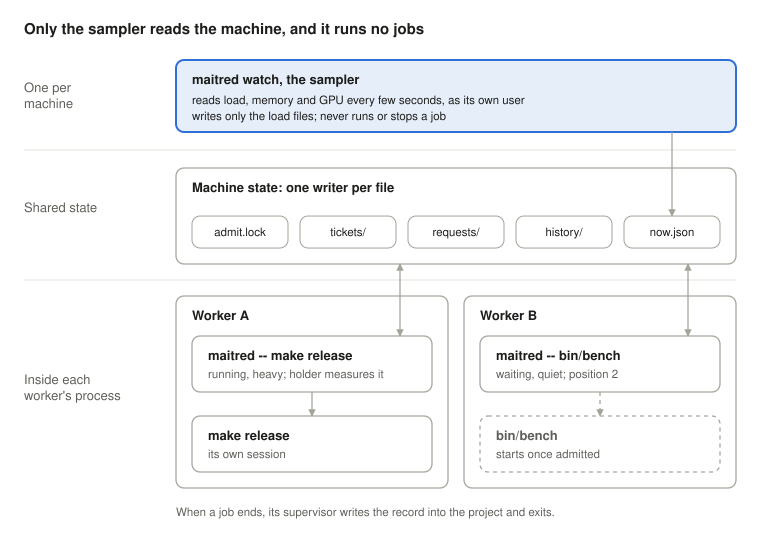

<!--
  Synced from the maitred design doc on claude.ai (rev 397, 2026-10-07):
  https://claude.ai/code/artifact/b0753fb5-a907-459b-8266-2b18f0401e5b
  Draft and revise there; this file is regenerated from it, so edits made only here are lost.
  The architecture drawing is docs/architecture.svg, exported from the doc's drawing.
-->

# maitred design

2026-10-07 · Nicholas Allen Bickford Marshall

maitred (pronounced "mate-urd") is a queue that only permits or defers jobs and records how each run went; the job always executes inside the process that enqueued it. It is for one machine shared by many independent workers, typically AI coding agents each in its own sandbox, that each want to run something heavy: a build, a mutation test, a benchmark, a data load.

## Terms

| Term | Meaning |
| --- | --- |
| worker | A process that asks maitred to run something: an agent session, a script, a person at a terminal |
| job | The command a worker wants to run |
| ticket | A job's place in the queue: its command, class, reservation, and an id made of its enqueue time and pid |
| class | How a job is treated: `light`, `heavy`, `quiet`, or `none` (not queued) |
| class file | Reviewed per-project config saying which commands go through maitred, and in which class |
| reservation | The cores and memory a job is assumed to use while it runs (other named resources can come later) |
| admission | The decision that a waiting ticket may start now |
| live floor | Limits on measured free memory and CPU below which nothing starts, whatever the reservations say |
| quiet | The class for jobs that need an otherwise idle machine, such as benchmarks |
| supervisor | The maitred process that waits for a ticket, then runs and watches its job. It is the worker's own process |
| sampler | `maitred watch`, the one process that reads the machine's load and publishes it. It never runs or stops a job |
| orphan | A ticket whose supervisor has gone: a crash, a closed session, a reboot |
| adoption | A worker taking over an orphan with `maitred wait`, becoming its supervisor |
| result | The record of a finished run: exit status, timings, the load samples around it, and a capped copy of its output if asked |

## Problem

maitred grew out of one developer's laptop (8 cores, 16 GB) running several AI coding agents at once, each in its own sandbox and each free to start a mutation test or a full build when its task called for one. Twice in three days they started heavy jobs together and took the machine down: once by exhausting memory, once by starving the CPU until the operating system's watchdog reset it [1]. The fix was a lock: one heavy job at a time, everyone else refused. It worked, in the same way that a hammer can absolutely kill an ant if you need to kill an ant. Agents spent their time retrying in loops, ran in no particular order, and waited behind jobs that would have fit beside them [2].

The general problem: independent workers share one machine and nothing coordinates them. Each sees only its own job; none can see the machine's load, which a sandbox may hide from it. And the obvious coordinator, a daemon that runs queued jobs, is a sandbox escape: it runs whatever it is handed, with its own rights. So that's what this program does: maitred coordinates without executing *anything*.

maitred must:

1. Run waiting jobs in a defined order, with no retry loops in workers.
2. Show who holds the machine and who waits.
3. Admit work that fits under current load instead of making it wait.
4. Let jobs that need a quiet machine run on a quiet machine.
5. Never let many workers start at once on a stale reading of load.
6. Do all of that without running anything outside the requesting worker's process and sandbox.
7. Run cleanly in a standard terminal on macOS and Linux, and inside containers.
8. Record load and runs in one OpenTelemetry-compatible shape on every machine.

## Principle and threat model

**The sampler observes, maitred decides, and every job runs and dies inside the process that asked for it, in that process's sandbox.**

The threat is not a hostile outsider. It is an agent that means well and takes a shortcut: claims a light class to skip the queue, edits a script the queue trusts, or wraps a job to keep the machine awake. The design has to hold when that happens.

**No process outside the sandbox runs a submitted job.** A daemon that executes queued commands runs them with its own rights, without the sandbox and without a permission prompt. An allowlist does not close that: an allowed command still runs code agents write (a build of any branch, a script in the repository). So every off-the-shelf queue that executes jobs from a daemon is ruled out:

| Tool | Why not |
| --- | --- |
| pueue | Its daemon runs the jobs: the escape above. No load-aware admission |
| task-spooler, nq | task-spooler runs jobs from a daemon. nq has the right model (no daemon, a lock per job) but runs strictly one job at a time, with no load or classes |
| GNU parallel `sem --load` | Waiter-side and load-aware, but no visible queue, no classes, no ordering guarantee |
| macOS `batch` / atrun | Load-aware, but off by default and enabled through a root launchd job |

**One process reads the machine: the sampler.** It exists so that workers never need system-introspection tools (`ps`, `top`, `pmset`, `/proc`) at all; a sandbox that hides them is one reason to want that, not the only one. It publishes what it reads to the load files, executes nothing it is given and stops nothing, so whether it runs inside a sandbox or not, it gives no worker more power.

**Safety never rests on data an agent can edit.** A job's class orders the queue; the live load decides whether anything may start. A wrong class can cost a slower queue or a spoiled timing, not an overloaded machine.

## Architecture

maitred supports two modes:

- `maitred watch`, the sampler, reads the machine and publishes its load. It's global to the machine or container that ran `maitred watch`.
- `maitred run` (or `maitred -- <cmd>`) is executed by each worker in its own process and sandbox; it queues, decides and supervises one job.



Each supervisor writes only its own ticket and reads everyone else's; the sampler writes only the load files.

A job's life:

1. **Enqueue.** The worker starts `maitred -- <cmd>` as a background call. The supervisor matches the command against the project's class file, creates its own ticket file in the machine state, and locks it for as long as it lives.
2. **Wait.** Every few seconds, in its own process: take admit.lock, read every ticket and the load file, run the admission function, release. The model is not involved.
3. **Run.** Once admitted, the supervisor marks its own ticket admitted and starts the command in a new process group, still inside the worker's sandbox.
4. **Finish.** The supervisor writes the record into the project's .maitred/ (exit status, times, sleep, any kill), deletes its own ticket and exits with the job's status. The background call ending wakes the worker.

## State on disk

State lives in two places, and neither knows where a job's output goes. **Machine state** (one per machine) holds only what coordination needs: one small file per live ticket and the sampler's load file, with no records, logs or class lists. **Project state** (`.maitred/` in each project) holds that project's class file and its run records, written only by that project's supervisors. When a run ends, its record goes to the project and its ticket leaves the machine state, so nothing needs syncing. Every file is plain, and every live one is owned by a process holding a kernel lock on it.

The machine root is `$MAITRED_ROOT`, by default `$XDG_STATE_HOME/maitred` (`~/.local/state/maitred`). It must be writable by every process that uses the queue, including from inside a sandbox, where `$TMPDIR` often differs from outside it. It is persistent on purpose: **queued work survives a reboot**, so a session resumed after one does not have to enqueue everything again.

```
<machine root>/              one per machine
  admit.lock                  locked while deciding admission; never written
  tickets/<time>-<pid>.json   one per live ticket; written and locked only by its supervisor
  cancel/<time>-<pid>         a cancel request, written only by whoever cancelled
  load/now.json               the latest sample; written only by maitred watch
  load/history.jsonl          OTel data points; written only by maitred watch
```

```
<project>/.maitred/                one per project
  classes                          the class file (read from the default branch)
  results/<time>-<pid>-<label>/    job.json, log, exit (gitignored)
```

| File | Holds | Written by |
| --- | --- | --- |
| ticket (`tickets/<time>-<pid>.json`) | id, project path, class, argv, cwd, label, reservation (cores, MB), state (waiting or admitted), queued_at, admitted_at | its supervisor, while it holds the ticket's lock |
| `.maitred/results/…/job.json` (in the project) | the ticket plus started, ended, exit status, whether the machine slept, whether it was killed and why | its supervisor, when the job ends |
| `load/now.json` | sampled_at, load averages, CPU busy over the last interval, free memory, processes, sleep assertions | `maitred watch` only |

**maitred keeps a record of the run, never the job's output.** In a result, `exit` is the exit status and `log` is a copy of stdout and stderr. The job's real output goes wherever its own command sends it, relative to its own working directory, exactly as without maitred. Output streams through to the worker as usual; the copy in `log` is capped (configurable), or off.

Worked examples, to test the shape:

| Job | Its output | What the result holds | What it reserves |
| --- | --- | --- | --- |
| CSV export: `psql -c "\copy (…) to 'out.csv' csv"` | `out.csv` in the worker's directory | exit status, timings, the first and last part of any log | cores, memory, and one connection to the database |
| Postgres import: `pg_restore -j 4 dump.tar` | rows in the database | exit status, timings, pg_restore's messages | 4 connections, disk I/O, cores |
| Scraping with curl: `bin/fetch-pages urls.txt` | pages written under `pages/` | exit status, timings, which URLs failed | network politeness: at most one request at a time per host |

Two of these load things that are not cores or memory: connections to one database, requests to one host. **v1 reserves cores and memory only.** A reservation is stored as a map of named amounts, though, so named resources with a declared capacity (`pg:main=4`, `net:example.com=1`, as Bazel does with `--local_resources`) can be added later without changing the ticket format.

**Several projects on one machine share one queue.** The resource being rationed is the machine, so every maitred-enabled project uses the same machine state; class files and run records stay in each project. Each ticket is classified by its own project's class file and labelled with the project, so their jobs interleave in one order and `maitred status` shows them all. A job that itself calls maitred runs straight through instead of queueing behind itself.

**Liveness is a lock, not a pid.** Each supervisor keeps an exclusive flock on its own ticket for as long as it lives. Anyone can try that lock without waiting: if it can be taken, the owner is gone. That works inside the sandbox (no `ps`, no `kill -0`), survives pid reuse, and needs no heartbeat.

**One writer per file.** All supervisors share the machine directory, but each file has exactly one writer: a ticket by its supervisor, a cancel request by whoever cancelled, the load files by the sampler. Everyone else only reads. The writer of a file is whoever holds its lock, so a dead owner's ticket is written again only by whoever takes the lock over: a worker adopting it, or a supervisor removing an expired orphan. Admission is decided under `admit.lock`, which is locked, never written, so two waiters can't both conclude they are next. Every file is written to a temporary name and renamed into place, so a reader never sees half a file. Ticket ids sort by enqueue time, with the pid breaking ties, so the order needs no shared counter.

**Orphans and adoption.** A ticket whose lock can be taken has lost its supervisor: a crash, a closed session, a reboot. Nobody writes it while it is orphaned, and it keeps its place in the queue. `maitred wait <id>` adopts it: the caller takes the ticket's lock and becomes its supervisor, inside its own sandbox, so the no-daemon rule holds. A job that was running when its supervisor died is marked `interrupted`, never restarted silently; adopting it re-queues it, because only the requester knows whether running it again is safe.

**Cleanup.** An orphan nobody adopts within the orphan time (configurable) is removed by the next supervisor that takes its lock, which makes that supervisor its writer for the moment it takes to delete it. Each project's supervisors delete that project's records older than 7 days. No separate janitor exists.

## Admission

Every waiting supervisor runs the same pure function over the same state, under admit.lock, and starts its job only when that function admits its own ticket; nobody else picks.

| Class | Admitted when | Under high load |
| --- | --- | --- |
| light | its reservation fits, and no quiet job is running or due | waits only at the live floor |
| heavy | its reservation fits, fewer than N heavy jobs run, and the settle time since the last heavy start has passed | bumped: light jobs behind it may pass |
| quiet | nothing admitted by maitred is running, and load has stayed under the quiet threshold for two samples in a row | waits for the machine to settle |

One pass of the function, in order:

1. **Freshness.** A load file older than 30 s means the sampler is down. maitred then falls back to what a plain lock does: one job at a time, of any class.
2. **Live floor.** Free memory under the floor, or CPU busy over the ceiling, admits nothing. This step ignores classes, so a wrong class can't get past it.
3. **Quiet barrier.** A running quiet job admits nothing else. A quiet ticket is due once it heads the queue or has waited past the aging time; from then on nothing new starts until it has run.
4. **Walk the tickets in enqueue order**, against a budget of cores and memory minus whatever is reserved by running jobs or measured as used, whichever is larger. Admit each ticket its class rule allows. A heavy ticket that has waited past the aging time stops the walk, so a stream of light jobs can't starve it.

**Reservations stop the thundering herd.** Load averages lag by about a minute, so ten waiters reading the same quiet snapshot would all start. An admitted job's reservation counts against the budget the moment it is admitted, before any load shows, and the settle time spaces heavy starts so the measurements catch up.

**Where reservations come from.** A class-file entry gives a fixed reservation, or names a checker command that prints one from what the project knows about the job (a dataset's measured cost, the size of its input). A ticket without one reserves its class default.

The numbers (capacity, the floor, the ceiling, the quiet threshold, settle and aging times, class defaults and per-class caps) live in the **machine config**, owned by the machine's user, not in any project. It always wins over what a project's class file claims, and a project's class file is validated where it is used (at enqueue, by `classes check`, in CI), never by the sampler. Starting values are an open question.

## Supervision

Each supervisor is the parent of its own job: it starts it, passes signals to it, records how it ended, and is the only process that may kill it.

- **Process group.** The job runs in a new process group, so a signal reaches everything it started. It does not inherit the ticket's lock: if it did, a daemon the job left behind (a file watcher, a preloader server) would keep the ticket looking alive.
- **Signals.** TERM, INT and HUP sent to the supervisor go to the job's group; after a grace period the supervisor sends KILL. A background call's timeout or Ctrl-C therefore stops the job and frees its reservation.
- **Orphaned processes.** If the supervisor itself is killed with KILL, its job can outlive it. The ticket records the group id, and admission keeps that ticket's reservation for as long as `pgrep -g` still finds the group, so the budget stays honest. A supervisor can't signal another session's processes from inside a sandbox; `maitred status` lists the group for a person to stop.

**Kill policy (after queueing works).** While its job runs, each supervisor reads the load file on every poll. When free memory falls below the kill floor, which sits below the admission floor, every supervisor runs the same pure function to choose one victim: the most recently admitted heavy job, then light, and a quiet job only below a critical floor. Only the victim's own supervisor acts: TERM to its group, KILL after the grace period, a result marked `killed: memory floor`. Nothing retries automatically.

**Sleep.** maitred never keeps the machine awake. It records how long the machine slept during the job by comparing a clock that stops in sleep with one that doesn't (`mach_absolute_time` and `mach_continuous_time` on macOS; Linux's pair is under Platforms). A quiet job that slept gets a result marked invalid, because its timing is.

## Class file

Each adopting project has one class file, kept in its repository and changed by pull request like any other reviewed config. It says which commands must go through maitred, and in which class.

A hook that forces heavy commands through maitred (Claude Code's PreToolUse, a shell wrapper) reads the same file, so "must be queued" and "in which class" never drift apart. The file is `.maitred/classes` at the root of the project's repository. Each row is `name | pattern | class | why`, with an optional `| checker`:

```
# name      | pattern                          | class   | why
mutation    | ^(bin/)?mutant +run( |$)          | heavy   | every core for hours
benchmark   | ^bin/bench( |$)                  | quiet   | its output is a timing; other load makes it wrong
release     | ^make +release( |$)              | heavy   | a full optimised build on every core
dataset     | ^bin/process-dataset( |$)        | checker | cost depends on the dataset | bin/dataset-cost
tests       | ^(bin/)?(rspec|cargo +test)( |$) | none    | the suite is short; run it directly
```

- **Matching.** A command loses its leading assignments and wrappers (`env`, `nice`, `time`, `timeout N`) before matching, as the guard does today. The first matching row wins.
- **Classes.** `light`, `heavy`, `quiet`, `none` (maitred refuses and says to run it directly), or `checker`.
- **Checkers.** A checker gets the command's arguments and prints a class and a reservation (`light 2 1200`: 2 cores, 1200 MB). It runs inside the sandbox like everything else. A project might, for example, read the measured cost of the dataset a job will process.
- **Unlisted commands are quiet,** the most restrictive class: a wrong guess in that direction costs only waiting.
- **A row without a `why` makes the file invalid.** maitred then treats every command as quiet and says why, rather than guess.
- **`caffeinate` anywhere in the argv is refused,** whatever the row says.

**Review is the protection.** maitred reads the class file as committed on the repository's default branch (configurable), not the working tree, so an edit does nothing until it has been reviewed and merged. That is also the shape an agent loop in production would need. For local development, `--classes <path>` or `$MAITRED_CLASSES` points at an unreviewed file: every run under it prints a warning, its result is marked `unreviewed-classes`, and `maitred status` shows it, so the override is easy to use and impossible to miss. A project outside git gets the same treatment. The CLI offers `classes check` (validate a file) and `classes propose` (draft a change for a pull request), never an apply step. maitred can't stop someone who can push to the default branch; it makes sure an unreviewed rule is always visible. A checker is code agents can edit, which is why the live floor, not the checker, keeps the machine safe.

## Platforms

maitred runs in a standard terminal on macOS and Linux, and inside containers, from v1.

|  | Load and memory | Sleep detection | Keeping the sampler running |
| --- | --- | --- | --- |
| macOS | host statistics and memory pressure through system calls | `CLOCK_MONOTONIC` minus `CLOCK_UPTIME_RAW` | optional launchd agent |
| Linux | `/proc/loadavg`, `/proc/meminfo`, `/proc/pressure/*` | `CLOCK_BOOTTIME` minus `CLOCK_MONOTONIC` | optional systemd user service |
| Container | the container's cgroup limits and usage (`memory.max`, `memory.current`, `cpu.max`), not the host's load average, which a container sees but cannot act on | as Linux | the container's entrypoint, or a sidecar |

- **The sampler is an ordinary foreground command.** `maitred watch` runs in any terminal; launchd, systemd or a container entrypoint are optional ways to keep it up.
- **One queue per machine.** Workers in several containers share a queue only through a shared state directory on the same kernel. Whether file locks hold across Docker Desktop's VM boundary on macOS (host processes and containers on one queue) is unverified and decides whether that setup is supported.

## Agent interface

An agent runs `maitred -- <cmd>` as a background call and gets woken when it exits with the job's own exit status; it never polls.

| Command | Does |
| --- | --- |
| `maitred [--label L] [--class C] -- <cmd>` (or `maitred run`) | Enqueue, wait, run, exit with the job's status. Output passes through; a capped copy is kept if asked |
| `maitred submit […] -- <cmd>` | Enqueue and start a detached supervisor, print the ticket id, exit at once |
| `maitred wait <id>` | Block until that job has a result, then exit with its status; adopts the ticket if its supervisor is gone |
| `maitred status [--project] [--json]` | Who runs and who waits (position, class, waited, reservation), the load file's age, orphans, unexpected sleep assertions; machine-wide, or one project's |
| `maitred result <id>` | Print the run record |
| `maitred cancel <id>` | Write a cancel request; the ticket's own supervisor sees it and stops its job. Works across sandboxes because nobody signals another's processes |
| `maitred update <id>` | Change a waiting ticket's label, or make its class stricter; nothing that could move it ahead |
| `maitred classes check` / `propose` | Validate a class file; draft a change for a pull request |
| `maitred export` | History and records through an exporter (v1: OTLP-JSON) |
| `maitred watch` | The sampler |
| `maitred install claude-code [--check]` | Install the agent skill and the PreToolUse hook, after showing every change and asking |

- **`--class` can only make a job stricter** (light to heavy to quiet), never lighter than its row. Otherwise it would be a way around the class file.
- **Exit codes.** The job's own status when it ran. 64 for a usage error, 77 when a rule refused it (`none`, `caffeinate`). A job killed at the memory floor exits as killed, and its result says why.
- **Messages** go to stderr with a `maitred:` prefix: queued at position 3, admitted after 4m10s, killed at the floor.
- **`submit` and `wait` exist for long queues and for adoption.** A background call has a time limit, and a timeout sends TERM, which would stop a waiting or running job. A supervisor started by `submit` is a detached child of a sandboxed shell, so it stays sandboxed; `wait` watches for its result, and adopts the ticket if its supervisor is gone.
- **`caffeinate`** (or any wrapper that holds the machine awake) is refused in the argv (77). `maitred status` lists sleep assertions held by processes the adopter hasn't declared expected, such as the agent harness's own.

**Left out on purpose:** pause, stash and reordering (pueue has them). They need a daemon or a shared writer.

**For agents.** maitred ships a skill for Claude Code (when to use it, running heavy commands as a background call, the exit codes, waiting for and adopting orphans), the same text as an AGENTS.md snippet for other harnesses, and an optional PreToolUse hook that wraps matching commands automatically. `maitred install claude-code` writes them only after a person confirms, since a hook is a person's decision. It ships no MCP server: one would run outside the sandbox and execute jobs, the escape this design rules out.

## Feature discovery

The closest prior art, [nq](https://github.com/leahneukirchen/nq), already has the right shape: no daemon, one file lock per job, jobs ordered by timestamp. Its README notes, in one neutral line, that it runs jobs "with no regard to the system's load average", and for nq that costs nothing: its rules are "exclusive execution is maintained strictly" and "polling is not used", so one queue runs one job at a time and load is bounded by construction. Load only needs measuring once independent workers share a machine, which is maitred's case. GNU [parallel](https://www.gnu.org/software/parallel/parallel.html) admits on load and free memory but has no visible queue or classes. maitred is nq's model plus admission, and it should borrow nq's habit of waiting on locks rather than polling wherever admission allows.

Candidate features, from prior art:

| Feature | From | Verdict |
| --- | --- | --- |
| Admit on reservations, clamped to capacity so a request larger than the machine still runs alone instead of deadlocking | Kubernetes requests, [Bazel](https://bazel.build/reference/test-encyclopedia) `cpu:n`, task-spooler `-N` | v1: already the design, plus the clamp |
| The first job always gets in, whatever the load | GNU [make](https://www.gnu.org/software/make/manual/make.html) `-l` | v1: one rule in the admission function |
| Exclusive class, checked before, sampled during, verdict after (a quiet run another job touched is marked tainted, not failed) | Bazel `exclusive`, pyperf, hyperfine, Google benchmark | v1: the quiet class, with an after-the-fact verdict |
| Cancel by killing the waiting process; `status --json`; `wait` by ticket or label | nq, pueue, task-spooler | v1 |
| Fail fast: give up after a timeout with its own exit code instead of waiting forever | task-spooler `-B` | v1: agents need it |
| Sleep detection on every run: macOS `CLOCK_MONOTONIC` minus `CLOCK_UPTIME_RAW`, Linux `CLOCK_BOOTTIME` minus `CLOCK_MONOTONIC` | the platform clocks | v1, read directly: Rust's `Instant` differs by platform |
| Suspend the job (SIGSTOP) under memory pressure and resume it when the floor clears, before resorting to kill | parallel `--memsuspend`, Buck2 suspension | v2: gentler than the kill policy |
| Self-applied limits on the admitted job: `taskpolicy` on macOS, `systemd-run --user --scope` on Linux (the caller stays the parent) | systemd, macOS | v2, if they work from inside a sandbox (unverified) |
| Age priority, named singletons, caps per label | Slurm, ninja pools | v2 |
| An external admission hook (exit 0 start, 1 hold, 2 kill youngest) | parallel `--limit` | later, only if it runs in the waiting process |
| Opt-in power assertion for one job's lifetime | `caffeinate -i`, `-w` | later, explicit flag only; no tool does this on request today |
| Backfill by expected runtime | Slurm | no: needs runtime history first |

**Telemetry is OpenTelemetry data from the start.** Every sample the sampler takes, and every result, is stored as OTel metric data points, one JSON object per line: resource attributes (`host.name`, `os.type`, `host.arch`), metric name, unit, value and timestamp, with names from OTel's host-metrics conventions (`system.cpu.utilization`, `system.memory.usage`, `system.cpu.load_average.1m`) and a `maitred.*` namespace for its own (`maitred.queue.waiting`, `maitred.job.duration`). `maitred export` turns the history into OTLP-JSON with no translation, so any OTel collector can take it, and every machine's data has the same shape by construction. Prometheus's textfile format was ruled out: it carries no timestamps.

Export goes through a small exporter interface between the stored data points and the output. v1 ships OTLP-JSON only, because that is where the ecosystem is aligning; other formats can be added later, built in or as plugins, without touching the sampler.

**Editing the class file:** settled; changes go through pull-request review (see Class file).

**Sleep.** Detection is always on (above). Keeping the machine awake is an explicit, per-job flag, if it exists at all.

**Name.** maitred, pronounced "mate-urd": a maître d' takes reservations, keeps the waiting list and seats you when a table is free. The working name, `jobq`, is taken on crates.io by an unrelated 2020 crate; `maitred` was free there when checked on 2026-10-07.

## Open questions

The first three are decided; the rest get answered by testing before the code depends on them.

**Decided (2026-10-07):**

- [x] Licence: MIT and Apache-2.0 together is the Rust convention.
- [x] Add crates.io to the sandbox network allowlist, or fetch dependencies outside the sandbox each time.
- [x] Run the sampler for a week in observe-only mode before admission is enforced, so the starting numbers come from this machine instead of guesses?

**To verify:**

- [ ] The time limit on a background Bash call, and whether a session's end kills detached children (decides how much `submit` and `wait` matter).
- [ ] That `mach_absolute_time` stops during sleep and `mach_continuous_time` doesn't.
- [ ] That `pgrep -g` works inside the sandbox, for orphan groups.
- [ ] The name is free on crates.io: `maitred` was, on 2026-10-07. Homebrew still to check.
- [ ] Linux: a second sampler backend (`/proc`) in v1, or macOS only at first.

## Notes

**[1] The two resets.** From the issue tracker of the first project to adopt the lock, gravedigger (a dead-code finder whose test runs dig large codebases), entries JOB-001, JOB-004, GEN-012 and GEN-013.

| Date | What was running | What failed |
| --- | --- | --- |
| 2026-09-28 | A full sweep of test codebases beside other jobs | Memory. The sweep capped memory with `ulimit -v`, which macOS doesn't enforce, and its backstop read memory through `ps`, which returned nothing inside the sandbox, so it saw 0 MB until the machine ran out and reset |
| 2026-09-30, 19:43 | 4 mutation-test runs and 3 full test suites from different sessions; load 60 to 110 on 8 cores | CPU. The window server stopped responding, macOS restarted it twice, and after 120 s the watchdog reset the machine. No memory kill came first |

A third episode the same week reached load 88 to 120 when two sessions dug at once; a timeout killed the job instead of the machine. Two lessons carry into the design: CPU alone can take a machine down, so the live floor has a CPU ceiling as well as a memory floor; and a memory reading that silently returns 0 is worse than none, so a missing or stale reading is treated as the most cautious case.

**[2] Thirty days under the lock** (2026-09-07 to 2026-10-07, read from the agents' session transcripts):

| Measure | Value |
| --- | --- |
| Jobs that held the lock | 164 |
| Refusals | 336, across 13 sessions |
| Polls of the lock's status in 14 days | 127 |
| Holds by jobs that never needed the lock (test suites) | 18 |
| Refusals caused by a single holder | 88 |
| Longest hold of a ~3 minute job | 00:13 to 07:04, across a machine sleep |

Most refused work would have fit: of 20 codebases dug under the lock, one was large enough to need it, and a typical dig used 1 to 2 cores and at most 1.2 GB.
